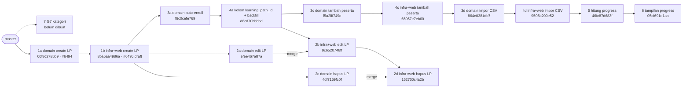
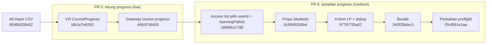
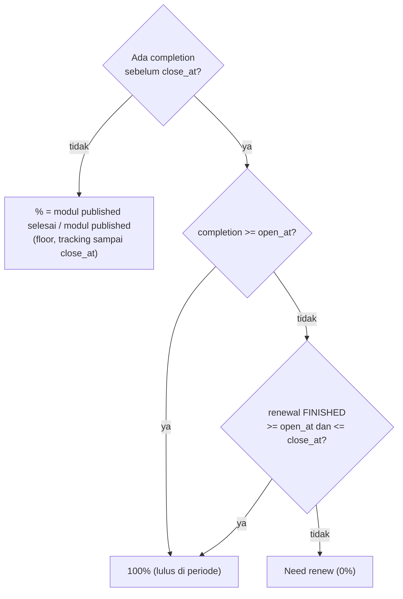

# Course progress is calculated automatically from Dicoding learning data (5 SP)

[Index Cycle 2](index.md) · [Card Basecamp](https://app.basecamp.com/5135326/buckets/44666023/card_tables/cards/10493257784)

## Kondisi saat ini

- APD lama: tab "Course Progress" (`User ID`, `CourseName`, `Progress Status` seperti 100.00%) disinkronkan `syncCourseProgress` ke Firebase, ditampilkan `CourseProgresses.vue`: progress bar per course (merah <35%, kuning <70%, hijau), 3 course pertama lalu bisa dibuka, teks "Last updated", course capstone dipisah lewat `capstoneProgress.courseName`.
- Progress bar halaman kelas Dicoding (`StudentOnCourseVM::getProgressPercentage`, `Dicoding/Web/VM/Academies/Index/StudentOnCourseVM.php:406`) = modul aktif selesai / total modul aktif, dibulatkan ke bawah. Sama persis dengan `CodingCampProgressiveCourseProgressChecker::getPercentages(userIds, courseId)` (batch).
- Pendaftaran AI Camp menyimpan `scholarship_participants.scholarship_package_id` (learning path) dan `category`. Config `scholarships.ai_camp.token_packages` memetakan id learning path ke `lp_name` dan `course_ids` (course token), per program di file config.
- Listener card [6] (`ParticipantEnrollmentSpecification`) masih mendaftarkan Student dengan `categoryId: null` dan TODO "map the registration category to the campaign category once that mapping exists". Event `ScholarshipCohortWasRegistered` hanya membawa `user_id` dan `program_id`.
- Capstone adalah Epic 7 di PRD (Fase 4), di luar card ini.

## Keputusan

Koreksi 2026-11-17 (Krisna): **kategori dan learning path berbeda.** Kategori = jenis Student (misalnya SMK, umum, guru SMK). Learning path = jalur belajar yang ditempuh Student (misalnya AI Engineer, Data Scientist). Daftar course mengikuti learning path, bukan kategori.

| # | Keputusan | Tanggal |
| --- | --- | --- |
| E1 | Konfigurasi course per campaign per **learning path**: `campaign_id`, `scholarship_package_id`, `course_id`, urutan. Dikelola Ops di admin campaign, pilihan learning path dari config program. Learning path tidak disimpan di access list (lihat P9) | 2026-11-17 |
| E2 | Rumus = progress bar halaman kelas (checker yang sudah ada). Tanpa aturan khusus "sudah lulus = 100%" | 2026-11-17 |
| E3 | Dihitung saat dibaca (real-time), query batch per course, tanpa disimpan dan tanpa cron | 2026-11-17 |
| E4 | Kolom progress di halaman Students admin (misalnya "x/y kelas selesai" plus detail per course). Tampilan untuk Student ada di card "Students see their learning progress in APD" | 2026-11-17 |
| E5 | Service juga menyediakan jumlah kelas lulus per Student, untuk card status otomatis nanti | 2026-11-17 |
| E6 | Capstone di luar scope (Epic 7) | 2026-11-17 |

## Pertanyaan terbuka

> Keputusan learning path sudah ada di [implementation-backlog.md](../Cycle%201/implementation-backlog.md): K3 dan K4 (kolom `learning_path` dan snapshot `lp_name`, dibatalkan) diganti K20 (2026-10-28): learning path dibaca saat dibutuhkan lewat `scholarship_participants.scholarship_package_id` dan lookup config. Card ini mengikuti K20.


- ~~P9. Sumber learning path peserta.~~ Terjawab 2026-11-17 dari komentar card [6] (Revamp APD Done):
  - Hasbi (2026-10-23): "learning path ini ganti2 setiap campaign dan namanya juga bisa beda2 makanya skrg ngambilnya dari config".
  - Krisna (2026-10-28): "untuk learning path jangan disimpan di access list, kalau butuh cukup join aja dengan tabel scholarship_participants lewat scholarship_package_id yang melakukan lookup ke config".
  - Commit terkait: `84534d215ca` (sempat menyimpan learning path di access list), lalu `82a8f118e97`, `35ffb230159`, `330bfa1974c` (dihapus lagi, 2026-10-28).
  - Akibatnya: tanpa kolom baru dan tanpa CRUD. Learning path Student = `access_list.user_id` + `program_id` campaign → `scholarship_participants.scholarship_package_id` → nama dari config program (`token_packages[id].lp_name`). E1 dikaitkan ke `scholarship_package_id`.
- P10. Peserta yang ditambah manual atau CSV (card [3]) dan tidak punya baris `scholarship_participants` tidak punya learning path, jadi course progress-nya kosong. Perlu dipastikan apakah kasus ini ada di campaign nyata.
- P11. Lookup config per program: daftar learning path di form konfigurasi course diambil dari config program campaign (misalnya `scholarships.ai_camp.token_packages`). Perlu dicek cara memetakan campaign ke kunci config programnya.

## Rincian SP (draft)

Rumus progress tidak perlu dibuat (E2, checker yang sudah ada, 0-100 per course). Pekerjaan utama card ini adalah menentukan **course apa saja** per learning path. Lihat bagian "Sumber daftar course" di bawah.

| Bagian | A1 (CSV) | A2 (form sederhana) | A3 (form lengkap) |
| --- | --- | --- | --- |
| Fitur setup course per learning path (migration, domain, gateway, UI, test) | 1 | 1,5 | 2 |
| Service baca (join learning path K20, ambil daftar course, `getPercentages()` batch) | 0,5 | 0,5 | 0,5 |
| Kolom progress di halaman Students admin (E4) | 0,5 | 0,5 | 0,5 |
| **Total** | **2** | **2,5** | **3** |

- Usulan Claude: **A1 = 2 SP**, atau 2,5 dengan buffer (kalibrasi card [3] dan [4]: pekerjaan lintas domain, web, dan CSV cenderung melebihi estimasi). Varian belum diputuskan Krisna (2026-11-17).
- Risiko membengkak: P11. Kalau cukup mendukung bentuk config AI Camp (`lp_name` + id), angka tetap. Kalau harus mendukung semua bentuk `token_packages`, tambah sekitar 0,5.

## Sumber daftar course (2026-11-17)

Temuan:

- `token_packages` di config program berisi course **tes seleksi** (koreksi Krisna), bukan course yang ditempuh Student. Config hanya dipakai untuk mengenali learning path (`scholarship_package_id`, `lp_name`, K20). Bentuk `token_packages` juga berbeda antarprogram (ada yang `lp_name` + `course_ids`, ada yang list id langsung, misalnya paket AWS di `config/scholarships.php:166`).
- APD lama tidak tahu course per peserta. Daftar course = baris yang disusun Ops di sheet olahan (tab "Course Progress": `User ID`, `CourseName`, `Progress`), disalin apa adanya oleh `syncCourseProgress`. Nama course hanya teks, bukan id course Dicoding.
- Dicoding punya katalog `learning_paths` + `learning_path_courses` (berurutan). Dulu `scholarship_participants.chosen_learning_path_id` FK ke katalog, lalu 2024 diganti nama menjadi `scholarship_package_id` dan FK dihapus. Menurut Krisna, learning path program biasanya berbeda dengan learning path katalog.

| Opsi | Cara kerja | Status |
| --- | --- | --- |
| A. Ops mengatur per learning path | Admin campaign: pilih learning path (dari `lp_name` config), tambah course, atur urutan | **Usulan.** Paling aman, sesuai AC "Ops menentukan course yang dihitung". Fitur baru di pengaturan campaign, tapi memang diminta AC |
| B. Dari token kelas Student | `multi_course_token_courses` milik token Student di program itu | Ditunda. Risiko: token seleksi dan token kelas bisa satu program, token bisa diberikan bertahap, Student bisa punya beberapa token |
| C. Dipetakan ke learning path katalog | Course dari `learning_path_courses` | **Gugur**: learning path program berbeda dengan katalog (Krisna, 2026-11-17) |
| D. Dari enrollment selama campaign | Semua course yang di-enroll dalam periode campaign | Gugur: course pribadi ikut tampil, course yang belum di-enroll tidak tampil |

Varian A:

| Varian | Bentuk | SP fitur setup |
| --- | --- | --- |
| A1. CSV saja | Unggah `learning_path, course_id, urutan` di pengaturan campaign, daftar tampil read-only. Unggah ulang menggantikan daftar learning path itu. Pola baris gagal seperti import lain | 1 |
| A2. Form sederhana | Tab "Courses": per learning path input id course (nama tampil setelah validasi), hapus, urutan berupa nomor | 1,5 |
| A3. Form lengkap | A2 + pencarian course (combobox) + drag-and-drop urutan | 2 |

Alasan usulan A1: setup jarang (sekali per campaign, sekitar 10 course per learning path) dan Ops biasanya menyusunnya dari timeline yang sudah berbentuk tabel. A2 bisa ditambah belakangan kalau Ops perlu edit satu per satu di tengah campaign.


## Pembaruan 2026-11-17 (komentar card dan keterkaitan dengan status)

**Komentar Hasbi (2026-11-16):**
- Progress hanya dihitung untuk aktivitas selama program berjalan. Filter ini dibantu dari sistem.
- Student yang sudah menyelesaikan course sebelum campaign dimulai dihitung **0%**, dan harus me-renew course agar dianggap selesai. Request dari Wintari Yasmin: tampilkan **NEED RENEW** (merah), lalu 100% hijau setelah renew selesai.
- Attendance, assignments, dan point histories kemungkinan tetap diisi manual (bukan card ini).

**Komentar Krisna (2026-11-17):** perhitungan progres berdasarkan learning path pendaftar, jadi sistem harus tahu course mana saja per learning path. Learning path diambil dari config (K20). Opsi: daftar course di config, atau Ops mengatur course per learning path saat setup campaign. Card ini saling terkait dengan card progress status, dan learning path kemungkinan perlu disimpan di DB (misalnya `campaign_learning_paths`).

**Usulan:** tabel konfigurasi opsi A (E1) diperluas dengan kolom `target_week` supaya dipakai juga oleh kalkulator status ([bagian 4](04-progress-status.md)).
- Nama usulan: `academic_program_dashboard_learning_path_courses` (`campaign_id`, `scholarship_package_id`, `course_id`, `target_week`, audit).
- `target_week` menggantikan fungsi `order` untuk urutan tampilan (urut berdasarkan `target_week`, lalu id). Perlu dikonfirmasi apakah `order` terpisah masih dibutuhkan.
- Learning path tetap tidak disimpan di access list (K20). `scholarship_package_id` dipakai sebagai kunci learning path di tabel konfigurasi ini.

**Catatan teknis:**
- `developer_journey_completions.created_at` bisa dipakai untuk membedakan kelulusan sebelum dan selama periode program, termasuk kasus renew (baris baru).
- `CodingCampProgressiveCourseProgressChecker` menghitung modul selesai tanpa batas waktu. Persentase dalam periode program butuh filter tanggal pada data modul, dan ini belum dicek.

**Rincian SP (draft baru): 3 SP**

| Bagian | SP |
| --- | --- |
| Konfigurasi course per learning path di setup campaign (A1) | 2 |
| Kolom `target_week` di form dan tabel | 0,5 |
| Filter periode program + status NEED RENEW | 0,5 |
| **Total** | **3** |

**Yang perlu diputuskan:**
- **Q2.** Kelas yang dihitung lulus hanya course di daftar learning path dan yang selesai dalam periode program? (sama dengan Q2 [bagian 4](04-progress-status.md))
- **Q5.** Filter periode program dan NEED RENEW masuk card ini atau ditunda? Kalau ditunda, SP turun ke 2,5.


## Keputusan 2026-11-18 (learning path, course, renew, freeze)

**Kelas yang dihitung (Q2, Krisna):** course dari learning path program yang selesai selama program. Kalau course sudah 100% atau sertifikatnya sudah dicetak sebelum program, Student perlu **renew certificate**. Fitur renew sudah ada di Dicoding.

**Mekanisme renew di Dicoding (dicek 2026-11-18):**
- Renew dicatat di `course_certificate_renewals` (`student_id`, `course_id`, `status`, `finished_at`). Selesai = status FINISHED. Lihat `CourseCertificateRenewalGateway::setAsRenewed`.
- Renew **tidak menambah baris** di `developer_journey_completions`. `MultiCourseTokensGateway` membaca `completions.updated_at` sebagai `renewed_at`.

**Aturan progress per course (Q3 dan Q5, Krisna):**

| Kondisi course di learning path | Progress | Dihitung lulus untuk status? |
| --- | --- | --- |
| Completion di antara `open_at` dan `close_at` | 100% | Ya |
| Completion sebelum `open_at`, lalu renew FINISHED dalam periode | 100% | Ya |
| Completion sebelum `open_at`, belum renew | **NEED RENEW** (merah) | Tidak |
| Belum selesai | % modul dari penghitung yang sudah ada. Modul yang dikerjakan sebelum program tetap terhitung | Tidak |

- Filter tanggal per modul **tidak perlu**. Cukup cek tanggal di completion dan renewal.
- **Freeze (Krisna: ya):** setelah `close_at`, progress dan status dibekukan di kondisi `close_at`. Kelulusan sesudahnya tidak mengubah apa pun. `open_at` dan `close_at` diambil dari tabel `academic_program_dashboard_campaigns`.
- Q5: filter periode dan NEED RENEW **masuk card ini**.

**Setup course (Krisna):** dilakukan di setup campaign dengan input manual. Per learning path, Ops memilih course lewat **combobox** dan mengisi `target_week`. Tidak ada CSV dan tidak ada drag and drop.

**Kolom `order`: tidak dipakai (Krisna).** E1 lama (yang menyertakan `order`) diganti. Urutan tampil = `target_week`, lalu nama course. Perhitungan status hanya butuh `target_week`, karena yang dihitung adalah jumlah kelas lulus.

**Learning path disimpan di tabel baru per campaign (Krisna). K20 gugur:**
- K20 (2026-10-28) melarang learning path disimpan di access list, karena nama learning path berganti per campaign dan diambil dari config.
- Dengan tabel per campaign, alasan itu tidak berlaku lagi.

Desain usulan:

`academic_program_dashboard_campaign_learning_paths`

| Kolom | Keterangan |
| --- | --- |
| `id` | increments |
| `campaign_id` | FK ke campaigns, cascade |
| `name` | Nama learning path di campaign ini, diisi Ops |
| `scholarship_package_id` | nullable. Pemetaan ke pilihan learning path di form registrasi, khusus peserta auto-register. Kosong untuk campaign tanpa registrasi Dicoding |
| timestamps | |
| unique `(campaign_id, name)` dan `(campaign_id, scholarship_package_id)` | NULL boleh lebih dari satu |

`academic_program_dashboard_learning_path_courses`

| Kolom | Keterangan |
| --- | --- |
| `id` | increments |
| `learning_path_id` | FK ke campaign learning paths |
| `course_id` | FK ke course Dicoding |
| `target_week` | unsignedTinyInteger, minggu ke-N sejak `open_at` |
| timestamps | |
| unique `(learning_path_id, course_id)` | |

Access list: tambah `learning_path_id` (nullable FK).
- Peserta manual dan CSV: Ops memilih learning path. Karena itu learning path harus dibuat dulu sebelum menambah peserta (menjawab P10).
- Auto-register (card [6]): dipetakan dari `scholarship_participants.scholarship_package_id` ke `campaign_learning_paths.scholarship_package_id`. Menjawab P11, karena tidak perlu lookup config lagi.

**Alasan `scholarship_package_id` tetap ada:** pendaftar memilih learning path di form registrasi program, dan pilihannya tersimpan sebagai `scholarship_package_id`. Tanpa pemetaan ini, peserta auto-register masuk tanpa learning path, dan Ops harus mengisinya manual untuk ratusan peserta. Mencocokkan nama ke `lp_name` config dianggap rapuh.

**Keterkaitan dengan G7:** pemetaan registrasi ke campaign ini polanya sama dengan TODO kategori card [6] (kategori pendaftaran ke kategori campaign). Keduanya bisa dikerjakan bersama di listener auto-enroll.

**Rincian SP (draft, sebelum pecah):**

| Bagian | SP |
| --- | --- |
| CRUD learning path per campaign + pemetaan `scholarship_package_id` | 1 |
| Course per learning path (combobox + `target_week`) | 1,5 |
| `learning_path_id` di access list + pilihan di form tambah peserta/CSV + auto-enroll | 1 |
| Kalkulasi progress + NEED RENEW + freeze | 1 |
| **Total** | **4,5** |

**Belum diputuskan (Q7):** dipecah menjadi card baru "Ops sets up learning paths and their courses per campaign" (3,5 SP, mungkin plus TODO kategori [6]) dan card Course progress (1 SP, hanya kalkulasi dan tampilan)?


## SP final (2026-11-18): 5 SP, ditetapkan Krisna (sempat 4)

Estimasi Claude 5,5 SP:

| Bagian | SP |
| --- | --- |
| CRUD learning path + pemetaan `scholarship_package_id` | 1 |
| Course per learning path (combobox + `target_week`) | 1,5 |
| `learning_path_id` peserta (form tambah, CSV, auto-enroll) | 1 |
| Kalkulasi progress + NEED RENEW + freeze | 1 |
| TODO kategori [6] (G7), termasuk isian "Kategori registrasi" di form kategori campaign | 1 |

- Kolom course "x/y lulus" di daftar peserta admin dikerjakan di card Progress status, bersama kolom status.
- Krisna menetapkan **4 SP**. Selisih dengan estimasi Claude (sekitar 1,5 SP) menjadi risiko card ini. Kalau melebar, kandidat yang dikeluarkan adalah G7 (card sendiri, sekitar 1 SP).


- **Pembaruan:** Krisna mengubah judul card menjadi [5] (2026-11-18 07:11). Obsidian disamakan menjadi **5 SP**. Selisih dengan estimasi Claude tinggal sekitar 0,5 SP.


## Keputusan 2026-11-19 (sebelum implementasi)

- **Nama kolom tetap `scholarship_package_id`** di `academic_program_dashboard_campaign_learning_paths` (Krisna). Isinya key `token_packages` program (atau nilai tetap config untuk program satu paket seperti mastercard, `config/scholarships.php:862`), dan kolom ini di-join ke `scholarship_participants.scholarship_package_id` saat auto-enroll.
- **Kalkulasi progres tetap di card ini, ditambah tampilan kecil** (Krisna), supaya service-nya langsung terpakai. Kolom "x/y lulus" dan status tetap di card Progress status.
- **Freeze persentase modul bisa dilakukan:** `developer_journey_trackings.completed_at` (nullable, sejak migration 2021-06-17, diisi di `AcademyProgressGateway.php:589`). Persentase saat freeze = modul published dengan `completed_at <= close_at` (null dianggap selesai sebelumnya). Butuh query baru dengan batas tanggal, karena `CodingCampProgressiveCourseProgressChecker::getPercentages()` tidak memfilter tanggal.

## Keputusan 2026-11-19: course diambil dari MCT (komentar card Progress status)

Sumber: komentar Krisna di card [Ops manages Students' progress status](https://app.basecamp.com/5135326/buckets/44666023/card_tables/cards/10493257815), 2026-11-19 04:00 dan 04:32.

- Course di setiap learning path **diambil dari MCT berdasarkan `program_id`** campaign (`partner_program_id`), bukan dari semua course Dicoding.
- Alur setup: Ops menambah learning path campaign saat setup, lalu memilih course dari daftar course MCT program itu, lalu menentukan course yang harus selesai tiap minggu (`target_week`). Jumlah course per minggu dipakai untuk status peserta ([bagian 4](04-progress-status.md)).
- Dampak ke opsi di "Sumber daftar course": opsi A tetap (Ops mengatur per learning path), tapi **pilihan combobox dibatasi ke course MCT program**. Ini beda dengan opsi B lama (course dari token milik tiap Student), yang tetap ditunda.
- **Perlu dicek sebelum implementasi:** tabel MCT mana yang jadi sumber daftar course per program (misalnya `multi_course_token_courses` lewat token ber-`program_id`), dan cara memisahkan course tes seleksi dari course kelas kalau keduanya satu program.
- Card Ops edits **tidak lagi bergantung ke card ini** (learning path tidak diedit, lihat [02](02-ops-edits-participant.md)).

## Keputusan 2026-11-23 (sebelum rencana PR)

| # | Keputusan |
| --- | --- |
| R1 | **Opsi A, tampil sebagai tab di halaman Settings** (diputuskan 2026-11-23). Halaman `campaign-edit` diberi tab "Umum" (form Settings yang sudah ada, isinya tidak diubah) dan "Learning paths". Backend tetap terpisah: endpoint dan aggregate sendiri per learning path, `CampaignSettingsUpdate` tidak diubah, simpan per learning path tidak menyentuh pengaturan umum. Endpoint mengikuti pola Groups (index, store, update, destroy). Perubahan di tab Umum yang belum disimpan perlu dijaga saat pindah tab (peringatan atau isi form dipertahankan) |
| R2 | **Diganti 2026-11-23, lihat "Revisi R2" di bawah.** ~~Isi combobox course = semua course MCT program~~: DISTINCT `multi_course_token_courses.course_id` dari token dengan `program_id` = `partner_program_id` campaign. Course tes seleksi ikut tampil, Ops yang memilih. Data lokal Pijak 2027 (2208): token Assessment (5, 19, 86, 887), Not Eligible (1), Progressive (2, 3, 5, 10) |
| R3 | **`learning_path_id` peserta diisi dua arah (cara 1)**, supaya urutan setup tidak berpengaruh: listener auto-enroll mengisi kalau learning path dengan `scholarship_package_id` yang cocok sudah ada, dan saat learning path disimpan, peserta campaign dengan `learning_path_id` null dan paket registrasi sama ikut diisi. Satu sumber untuk semua jalur (auto, manual, CSV) |
| R4 | `scholarship_package_id` learning path **tidak bisa diganti** kalau learning path sudah punya peserta. Learning path yang sudah punya peserta **tidak bisa dihapus** (pola `CATEGORY_IN_USE`). **Diperjelas 2026-11-23:** mengisi paket dari kosong ke X tetap boleh walau sudah ada peserta, lalu backfill R3 dijalankan. Yang ditolak hanya X ke Y dan X ke kosong saat sudah ada peserta. Alasannya, peserta di learning path tanpa paket pasti dimasukkan manual, jadi tidak bergantung pada paket; kasus Ops lupa mengisi paket di tengah jalan selesai tanpa pemindahan manual. Aturan aggregate: tolak kalau sudah punya peserta DAN paket lama tidak kosong DAN paket baru berbeda |
| R5 | **G7 ikut card ini sebagai PR terakhir.** Kalau card melebar, PR ini yang dilepas |

### Revisi R2 (2026-11-23): course dipilih dari semua kelas Dicoding

**Keputusan:** daftar course di dialog learning path diambil dari semua kelas `developer_journeys` (hanya kelas published lewat `AcademyGateway::getPublishedCourses()`, sumber yang sama dengan form pembuatan MCT; semua dikirim sekaligus dan disaring di combobox client), bukan dari MCT program. Aturan domain "course harus ada di daftar course MCT program" diganti menjadi "course harus ada". Penanda "sudah dibagikan ke peserta" untuk course yang ada di MCT program tidak dibuat dulu (YAGNI), tambahkan kalau Ops meminta.

**Alasan:** `multi_course_tokens` adalah token per peserta (`student_id`, `redeemed_at`), dibuat saat grant atau offering, bukan paket course yang dibuat di awal. Kalau sumbernya MCT, daftar course kosong sebelum ada grant dan hanya berisi course yang kebetulan sudah dibagikan. Ini bertentangan dengan alur di thread (Ops menambah learning path saat setup campaign) dan dengan R3 (urutan setup tidak berpengaruh).

> Krisna (2026-11-23): "gimana kalo misalkan tim ops pengen setup campaign ini jauh jauh hari sebelum pendaftaran dibuka, atau dalam tahap registrasi? sedangkan MCT akan dibuat ketika offering ke peserta, otomatis kan courses tidak akan muncul di setup learning path, malah jadi telor-ayam"

**Risiko yang diterima:** Ops bisa memilih course yang tidak dibagikan ke peserta. Dampaknya terbatas: progress course itu terhitung 0% karena kalkulasi (PR 5-6) membaca tracking, completion, dan renewal peserta.

**Opsi yang ditolak:** tetap MCT (Ops harus grant dulu); config `auto_enroll_scholarship_token[program_code].scholarship_packages.*.course_ids` (bentuk berbeda per program dan program tanpa entri jadi kosong, masalah P11).

**Perubahan kode:** fixup di branch domain (aturan, pesan error, unit test), lalu branch 1b (gateway `isEveryCourseFound` cek course ada di `developer_journeys`; pilihan combobox dari `getPublishedCourses()`). Endpoint pencarian ke server sempat dibuat lalu dibatalkan: convention form admin di codebase memuat semua kelas sekaligus (form MCT, token kelas satuan, admin learning path katalog), dan production hanya punya 139 kelas published dari 319 total (dicek Krisna 2026-11-23).

### Klarifikasi peran MCT (2026-11-23 sore)

Keputusan "course diambil dari MCT" (2026-11-19) ternyata maksudnya untuk **menampilkan progress peserta**, bukan untuk sumber course saat setup learning path. Revisi R2 tetap berlaku.

- **MCT:** sumber daftar course yang dimiliki tiap peserta, berdasarkan `program_id`. Dipakai di tampilan progress (PR 5-6): peserta dapat course apa saja dari program itu.
- **Learning path:** tetap wajib mendefinisikan course apa saja dan target minggu ke-berapa tiap course harus selesai. Ini dasar status mingguan peserta, dan tidak bisa diambil dari MCT.

> Krisna (2026-11-23 15:31): "ohh maksudnya diambil dari MCT ini untuk nampilin progress siswa aja ya dia dapat course apa aja berdasarkan program id itu. Kalo ini make sense. Tapi kalo untuk bikin target minggu keberapa harus selesai x course, mau gamau setiap LP harus define course nya apa aja dan target per minggu nya berapa"

Konteks thread sebelumnya:

> Krisna (2026-11-19): "jadi flownya gini: tim ops bakal tambah learning path untuk campaign tersebut apa saja pas setup campaign, dan untuk coursenya bisa diambil dari MCT pake program id, nanti setelah ada tinggal tentukan setiap minggunya course apa aja yang harus diselesaikan peserta dan nanti diambil jumlahnya per minggu untuk menentukan status pesertanya"

**Perlu diputuskan sebelum PR 5:** bagaimana kalau course di learning path tidak ada di MCT peserta, atau sebaliknya peserta punya course MCT yang tidak ada di learning path? Apakah course itu tetap ditampilkan dan dihitung dalam status mingguan?

**Jawaban (2026-11-24, Krisna):** pertanyaan ini milik card Progress status, bukan card ini. Card Course progress hanya menghitung sejauh mana progress tiap course dan apakah perlu renew. Card Progress status yang membandingkan progress itu dengan `target_week` learning path untuk label seperti ahead of schedule.

> Krisna (2026-11-24): "jadi gini, ada 2 card berbeda tapi saling berkaitan, card kita yaitu course progress itu menghitung sudah sejauh mana progressnya dan apakah perlu renew? sedangkan card progress status itu berhubungnan dengna label ahead of schedule dan lainnya dari course progress dibandingkan dengan target week di learning path."

Akibatnya untuk PR 5-6: kalkulator tidak membaca learning path. PR 5 cukup kalkulator murni per peserta dan course, sehingga bisa berbasis `master`. Selisih course learning path vs MCT dipindah ke [[04-progress-status]]. O2 diputuskan saat PR 6.

## Rencana PR (2026-11-23)

Stack lurus, setiap PR di atas PR sebelumnya. Pemisahan mengikuti konvensi: PR domain (aggregate, VO, unit test, repository, gateway kosong, tanpa migration) lalu PR infra+web (migration, gateway, spec, web, integration test). TDD.

| PR | Isi | Perkiraan SP |
| --- | --- | --- |
| 1. Domain learning path | Aggregate learning path campaign: simpan (nama, `scholarship_package_id` nullable, daftar course + `target_week`) dan hapus. VO course learning path. Aturan: hanya admin; nama unik per campaign; paket unik per campaign; course harus ada di daftar course MCT program; course tidak duplikat; `target_week` >= 1 dan tidak melewati jumlah minggu campaign (`open_at` sampai `close_at`); R4. Repository + gateway kosong | 0,75 |
| 2. Infra + web learning path | Migration `academic_program_dashboard_campaign_learning_paths` dan `academic_program_dashboard_learning_path_courses`. Gateway (termasuk query course MCT program). Spec simpan dan hapus. Action dan route. UI: halaman `campaign-edit` dibungkus tab "Umum" dan "Learning paths"; tab Learning paths berisi daftar, dialog tambah/edit dengan combobox course dan input minggu, dan hapus; perubahan tab Umum yang belum disimpan dijaga saat pindah tab. Integration test jalur sukses, vitest halaman | 1 |
| 3. Domain `learning_path_id` peserta | Aggregate tambah peserta manual, CSV import, dan auto-enroll menerima learning path (harus milik campaign yang sama). Aggregate pengisian learning path peserta (R3, backfill saat learning path disimpan). Unit test | 0,5 |
| 4. Infra + web `learning_path_id` peserta | Migration kolom `learning_path_id` (nullable FK) di access list. Listener auto-enroll mencari learning path dari `scholarship_participants.scholarship_package_id`. Spec simpan learning path memanggil backfill. Form tambah peserta (pilihan learning path) dan kolom learning path di CSV. Integration test | 0,75 |
| 5. Domain kalkulasi progress | Kalkulator murni per course: 100% (completion dalam periode, atau renew FINISHED dalam periode), NEED RENEW (completion sebelum `open_at` tanpa renew), atau % modul; dibekukan di `close_at`; jumlah kelas lulus (E5). Unit test | 0,75 |
| 6. Infra + tampilan progress | Query batch: % modul dengan `developer_journey_trackings.completed_at <= batas`, completion, dan renewal per peserta dan course. Service baca. Tampilan kecil progress per course. Integration test | 0,75 |
| 7. G7 kategori | Pemetaan kategori registrasi ke kategori campaign (isian "Kategori registrasi" di form kategori), dipakai listener auto-enroll, ditambah backfill dengan pola R3 | 0,5 (+0,5 risiko) |
| **Total** | | **5** |

**Pertanyaan yang perlu dijawab sebelum PR terkait:**
- **O1 (PR 1-2), diputuskan 2026-11-23: pakai usulan.** Dari mana pilihan `scholarship_package_id` di form learning path? Usulan: dropdown dari DISTINCT `scholarship_participants.scholarship_package_id` program itu, ditambah `lp_name` dari config kalau ada. Isian angka bebas rawan salah. Cek dulu bentuk `token_packages` per program (P11).
- **O2 (PR 6).** Lokasi "tampilan kecil" progress: baris yang bisa dibuka di halaman Students admin, atau dialog detail peserta? Kolom "x/y lulus" tetap di card Progress status.
- **O3 (PR 4), diputuskan 2026-11-23: pakai nama.** Kolom learning path di CSV diisi nama learning path campaign, dicocokkan tanpa membedakan huruf besar/kecil. "Id" yang sempat dipertimbangkan adalah id row learning path, bukan id paket beasiswa (tidak semua learning path punya paket, dan pemetaan lewat paket sudah ditangani auto-enroll dan backfill). Nama yang tidak ditemukan ditolak per baris dengan alasan, tidak dibuat otomatis, karena learning path butuh daftar kelas dan minggu target, dan salah ketik akan menghasilkan learning path sampah. Kolom kosong berarti peserta tanpa learning path.

### Revisi rencana PR (2026-11-23): satu PR satu aksi

Konvensi codebase: **satu PR untuk satu aksi** (create, update, dan remove dipisah), masing-masing dengan pasangan PR domain lalu PR infra+web. PR 1 dan 2 di tabel atas dipecah menjadi:

| PR | Isi |
| --- | --- |
| 1a. Domain create learning path | VO `CampaignLearningPath` dan `LearningPathCourse`, aggregate `CampaignLearningPathCreation`, event, repository, gateway kosong. Aturan create saja |
| 1b. Infra + web create | Kedua migration, isi gateway (termasuk query course MCT program dan pilihan paket O1), spec, action, tab "Learning paths" di Settings dengan daftar dan dialog tambah |
| 2a. Domain update learning path | Aggregate update + R4 (paket tidak bisa diganti kalau sudah punya peserta) |
| 2b. Infra + web update | Spec, action, dialog edit |
| 2c. Domain remove learning path | Aggregate removal + R4 (tidak bisa dihapus kalau sudah punya peserta) |
| 2d. Infra + web remove | Spec, action, tombol hapus |

Cek "sudah punya peserta" (R4) baru bisa diisi setelah kolom `learning_path_id` ada (PR 4). Karena itu PR 2a-2d bisa ditaruh **setelah PR 3-4**, atau gateway-nya sementara mengembalikan "belum ada peserta" dengan TODO. PR 3 sampai 7 tetap, dan PR 3 serta 4 juga dipecah per aksi kalau berisi lebih dari satu aksi.

**Keputusan urutan (2026-11-23, Krisna):** PR 2a-2d (update dan remove learning path) dikerjakan **setelah PR 3-4**, supaya cek "sudah punya peserta" langsung memakai kolom `learning_path_id`.

### Urutan PR final (2026-11-23)

Menggantikan urutan di tabel "Rencana PR" dan "Revisi rencana PR". Satu PR satu aksi, stack lurus.

| Urutan | PR                                                | Isi singkat                                                                                                                                                                                                                   |
| ------ | ------------------------------------------------- | ----------------------------------------------------------------------------------------------------------------------------------------------------------------------------------------------------------------------------- |
| 1      | 1a. Domain create learning path                   | Selesai lokal, preflight valid, belum di-ack dan belum di-push. Branch `feature/apd/campaign-learning-path-domain`                                                                                                            |
| 2      | 1b. Infra + web create learning path              | Selesai lokal, preflight valid, belum di-ack dan belum di-push. Branch `feature/apd/campaign-learning-path-creation`, termasuk UI dan build (lihat "Status implementasi PR 1a dan 1b")                                        |
| 3      | 3a. Domain auto-enroll                            | Selesai lokal, belum di-push. Branch `feature/apd/participant-learning-path-auto-enroll`                                                                                                                                      |
| 4      | 4a. Infra auto-enroll                             | Selesai lokal, belum di-push. Branch `feature/apd/participant-learning-path-auto-enroll-storage` (migration kolom `learning_path_id`)                                                                                         |
| 4b     | Backfill saat learning path dibuat                | Selesai lokal, belum di-push. Branch `feature/apd/participant-learning-path-backfill`. **Digabung dengan 4a jadi satu PR** (2026-11-23): PR dibuka dari branch backfill dengan base 3a, branch 4a tidak dibuatkan PR sendiri. |
| 4c     | 3c/4c. Tambah peserta manual dengan learning path | Selesai lokal, belum di-push. Branch 3c `feature/apd/participant-learning-path-creation-domain`, 4c `feature/apd/participant-learning-path-creation`                                                                          |
| 4d     | 3d/4d. Impor CSV dengan kolom learning path       | Selesai lokal, belum di-push. Branch 3d `feature/apd/participant-learning-path-import-domain`, 4d `feature/apd/participant-learning-path-import`. Pakai nama learning path (O3)                                               |
| 5      | 2a. Domain update learning path                   | R4: paket tidak bisa diganti kalau sudah punya peserta (pakai kolom dari PR 4). Kosong ke X tetap boleh dan memicu backfill R3                                                                                                |
| 6      | 2b. Infra + web update                            | Dialog edit                                                                                                                                                                                                                   |
| 7      | 2c. Domain remove learning path                   | R4: tidak bisa dihapus kalau sudah punya peserta                                                                                                                                                                              |
| 8      | 2d. Infra + web remove                            | Tombol hapus                                                                                                                                                                                                                  |
| 9      | 5. Domain kalkulasi progress                      | 100% / NEED RENEW / % modul, freeze di `close_at`                                                                                                                                                                             |
| 10     | 6. Infra + tampilan progress                      | Query batch, tampilan kecil (O2)                                                                                                                                                                                              |
| 11     | 7. G7 kategori                                    | Pemetaan kategori registrasi, dilepas kalau card melebar                                                                                                                                                                      |

Konvensi test PR domain: hanya test aggregate, yang membangun aggregate lewat repository asli dengan gateway di-prophesize. Tanpa test repository terpisah dan tanpa test VO.

## Stack PR (2026-11-24)

Semua PR di bawah sudah lolos preflight. 1a (#6494) dan 1b (#6495, draft) sudah di-push, sisanya menunggu ack. Base tiap PR dipilih dari branch terendah yang punya semua yang dibutuhkan, supaya stack tidak terlalu dalam (lihat [[05-course-progress-preflight]]).



Versi teks:

```
master
 ├─ 1a ─ 1b ─┬─ 3a ─ 4a ─┬─ 3c ─ 4c ─ 3d ─ 4d ─ 5 ─ 6
 │           │           └─ 2b  (dari 4a, lalu 2a di-merge ke dalamnya)
 │           ├─ 2a ──────────┘
 │           └─ 2c
 │                 2d dari 2b, lalu 2c di-merge ke dalamnya
 └─ 7 (G7, belum dibuat)
```

Garis putus-putus di diagram mermaid berarti PR belum dibuat. 2b memakai dua induk: branch dibuat dari 4a (butuh kolom `learning_path_id`), lalu 2a di-merge lokal (bukan cherry-pick) supaya SHA commit 2a tetap sama. Setelah PR 2a merge ke master, diff PR 2b di GitHub otomatis hanya berisi perubahan 2b.

## Status implementasi PR 1a dan 1b (2026-11-23)

Keduanya selesai di lokal, sudah di-commit, belum di-push. Riwayat kedua branch sempat ditulis ulang (fixup + autosquash, lalu rebase 1b), jadi kalau pernah di-push perlu force push.

**PR 1a, `feature/apd/campaign-learning-path-domain`** (4 commit di atas master `b91c2a20adb`): VO learning path dan course, aggregate `CampaignLearningPathCreation`, event, repository, gateway kosong, terjemahan error. Aturan: hanya admin, nama unik per campaign, paket unik per campaign, setiap course harus ada (`COURSE_NOT_FOUND`, revisi R2), course tidak duplikat, `target_week` >= 1 dan minggu ke-N harus mulai sebelum `close_at`. `created_by`/`updated_by` tidak dipakai.

**PR 1b, `feature/apd/campaign-learning-path-creation`** (8 commit):
- Migration `academic_program_dashboard_campaign_learning_paths` dan `academic_program_dashboard_learning_path_courses` (tanpa kolom audit).
- Gateway: query dan insert learning path beserta course-nya dalam satu method (pola `MultiCourseTokensGateway`), tanpa transaksi sendiri karena `UseCase::run()` sudah membungkus spec dalam transaksi.
- Spec + integration test jalur sukses, action store + route `programcampaigns.learningpaths.store`, redirect ke `edit#learning-paths`.
- Props halaman Settings: daftar learning path, kelas published, pilihan paket (DISTINCT `scholarship_participants.scholarship_package_id` program, label `lp_name` dari config, O1).
- UI: tab "Umum" dan "Learning Path" (tab Umum tetap ter-mount supaya isian belum tersimpan tidak hilang), tabel daftar, dialog tambah. Bundle di-commit terpisah (`build(apd): rebuild the frontend bundle`).

**Keputusan UI dialog tambah (2026-11-23):**
- Kolom "Kelas", "Minggu ke-", "Tanggal" sebagai judul kolom di atas daftar, bukan placeholder (placeholder terpotong di input sempit).
- Tanggal minggu ke-N dihitung dari `open_at` campaign: mulai `open_at` + (N-1) minggu, berakhir 6 hari kemudian atau `close_at` kalau lebih dulu. Minggu yang mulai setelah `close_at` tampil "Di luar periode campaign". Format ringkas, misalnya "3 - 9 Nov 2026". Tabel daftar memakai format yang sama.
- Kelas yang sudah dipilih di baris lain tidak muncul di pilihan baris lain. Cek duplikat di zod, domain, dan server tetap ada sebagai pengaman.
- Nama kelas panjang: kolom kelas mengambil sisa lebar, nama lengkap muncul sebagai tooltip, dan item dropdown boleh membungkus teks.
- Tinggi dialog dibatasi tinggi layar dikurangi 10rem dan daftar kelas mengisi sisa ruang dengan scroll, supaya judul tidak tertutup navbar dan tombol Simpan tetap terlihat di layar pendek. Halaman terpisah dianggap berlebihan.

**Data lokal untuk mencoba (AI Camp):** partner program 1708 (override lokal `ai_camp`) diganti nama menjadi "AI Camp powered by DBS Foundation" dengan `program_code` `aicamp_2026`. Campaign id 2 "AI Camp" (3 Nov 2026 sampai 31 Jan 2027), kategori SMK dan Universitas, 6 peserta scholarship dummy (user 6 sampai 11, paket 1 dan 2, isian registrasi mengikuti format `CodingCampRegistrationData`). Dua row access list lama user 284 (`codingcamp_2026`) dihapus. Config lokal yang masih memakai kunci `codingcamp_2026` tidak lagi cocok dengan program 1708. Row uji "Smoke LP" di campaign 1 (Pijak) masih ada.

**Hasil preflight:** dipindah ke [[05-course-progress-preflight]] (temuan, check, digest, dan salinan report per PR).

**Temuan di luar scope:** unique key access list `(program_user_id, user_id, program_code)` membolehkan satu user punya dua row di campaign yang sama selama `program_user_id` berbeda, dan sejak `program_user_id` nullable, juga dua row dengan NULL. Relevan untuk PR 4 (`learning_path_id` bisa terisi di dua row, progress terhitung dobel).

## Status implementasi PR 3a, 4a, dan backfill (2026-11-23)

Stack: master, 1a, 1b, 3a, 4a, backfill. Semua sudah di-commit, belum di-push, belum di-preflight.

**PR 3a, `feature/apd/participant-learning-path-auto-enroll`** (2 commit):
- VO `Participant` ditambah `?int $learningPathId` tanpa default, mengikuti `categoryId` (tidak ada default `= null` di domain APD). `ParticipantCreation`, `ParticipantImport`, `ContributorCreation` mengirim `learningPathId: null`. Contributor tetap memakai VO yang sama karena VO ini mewakili satu row access list untuk semua peran; memisahkan VO `Contributor` dianggap refactor di luar scope.
- `ParticipantEnrollment` menerima `?int $learningPathId` dari repository, tanpa invariant baru. Gateway stub `findLearningPathIdByScholarshipPackage(userId, partnerProgramId)`.

**PR 4a, `feature/apd/participant-learning-path-auto-enroll-storage`** (3 commit):
- Migration kolom `academic_program_dashboard_access_lists.learning_path_id` (nullable, setelah `category_id`, FK `restrict` ke learning path).
- `createParticipant` dan `createParticipants` menulis kolomnya.
- Query: `scholarship_participants` join campaign (lewat `partner_program_id`) join learning path dengan paket yang sama.
- Sync Participants tidak diubah: peserta baru yang masuk lewat Sync otomatis dapat learning path karena memakai spec enrollment yang sama, tapi peserta yang sudah ada dilewati.

**Backfill, `feature/apd/participant-learning-path-backfill`** (2 commit): saat learning path dengan paket X disimpan, dalam transaksi yang sama semua STUDENT campaign itu dengan paket registrasi X dan `learning_path_id` NULL diisi. Learning path tanpa paket tidak memicu backfill, peserta yang sudah punya learning path tidak dipindah. Auto-enroll hanya berjalan sekali saat cohort form diisi, jadi tanpa backfill peserta yang terdaftar sebelum learning path dibuat tetap NULL. Alternatif menghitung learning path saat dibaca (tanpa disimpan) ditolak karena setiap query progress jadi bercabang dan peserta ikut pindah diam-diam kalau paket diganti.

**Alasan `learning_path_id` nullable:** peran selain STUDENT (dosen, mentor), campaign tanpa learning path, learning path untuk paket peserta belum dibuat (diisi backfill), data access list lama, dan tambah manual atau CSV dengan kolom kosong. Bukan karena peserta tanpa paket: `scholarship_participants.scholarship_package_id` NOT NULL.

## Status implementasi PR 3c, 4c, 3d, dan 4d (2026-11-23)

Stack: master, 1a, 1b, 3a, 4a, backfill, 3c, 4c, 3d, 4d. Semua sudah di-commit, belum di-push, belum di-preflight (preflight baru untuk 1a dan 1b).

Dengan ini student mendapat learning path lewat empat jalur: auto-enroll saat cohort form diisi (3a/4a), backfill saat learning path dibuat, tambah manual (3c/4c), dan impor CSV (3d/4d).

**PR 3c, `feature/apd/participant-learning-path-creation-domain`** (3 commit):
- Gateway stub `getLearningPathIdsByProgramCode`, terjemahan `PARTICIPANT_CREATION.LEARNING_PATH_NOT_IN_CAMPAIGN`.
- `ParticipantCreation::create(?int $categoryId, ?int $learningPathId)`: learning path harus milik campaign ini, dicek setelah kategori. Kosong tetap boleh.
- Spec: rule `learning_path_id` `nullable|integer|min:1`, label "Learning path".

**PR 4c, `feature/apd/participant-learning-path-creation`** (5 commit):
- Query id learning path per `program_code` dan pilihan learning path per campaign (urut nama).
- Action store mengirim `learning_path_id`, halaman Students menerima prop `learningPaths`.
- Dialog tambah peserta: Select "Learning path" dengan pilihan "No learning path". Bundle di-commit terpisah.

**PR 3d, `feature/apd/participant-learning-path-import-domain`** (4 commit):
- Pembaca CSV membaca kolom `learning_path`.
- Kolom dicocokkan dengan **nama** learning path, tanpa membedakan huruf besar kecil dan spasi di ujung, sama seperti kategori. Nama yang tidak ada di campaign ditolak per baris (`LEARNING_PATH_NOT_IN_CAMPAIGN`), tidak dibuat otomatis.
- Student terdaftar memakai aturan kunci sekali seperti `program_user_id`: learning path kosong diisi; nama yang sama dilewati; nama berbeda ditolak per baris (`LEARNING_PATH_ALREADY_SET`); kolom kosong tidak menghapus learning path. Alasannya keputusan L1: learning path peserta tidak diganti lewat impor.
- `EnrolledParticipant` dan event `ParticipantWasUpdated` membawa `learning_path_id`.

**PR 4d, `feature/apd/participant-learning-path-import`** (3 commit): query nama learning path per `program_code`, `updateParticipant` ikut menulis `learning_path_id`, keterangan kolom di dialog impor, build. Integration test impor mencakup peserta baru dan peserta lama yang learning path-nya masih kosong.

**Template impor** ([APD Import Template](https://docs.google.com/spreadsheets/d/1fdLxbSePC0NVPFcL-03uwleyKDoj0nIKNKuQc1PRPNU/edit)): sheet "Import Students" ditambah kolom `learning_path` (isi nama learning path persis seperti di tab Learning Path campaign, boleh kosong). Sheet "Mapping Student-Lecturer" tidak berubah.

**PR 2a, `feature/apd/campaign-learning-path-update-domain`** (4 commit di atas 1b `8ba5aa4986a`, base 1b supaya stack dangkal):
- Cek minggu target pindah ke `CampaignLearningPath::fitsCampaignPeriod`, dipakai aggregate create dan update (mengubah file dari 1a).
- Aggregate `CampaignLearningPathUpdate`: hanya admin, nama dan paket unik per campaign (selain dirinya), course harus ada, minggu target muat di periode campaign, R4: kalau sudah punya peserta paket tidak boleh diganti atau dikosongkan; kosong ke X dan paket sama tetap boleh.
- Event `CampaignLearningPathWasUpdated`, repository create dan save, stub gateway (`findLearningPath` mengembalikan `?object`, `hasStudents`, cek nama/paket dipakai learning path lain, `updateLearningPath`), 8 key terjemahan.
- Preflight selesai (medium, 0 temuan), menunggu ack. Lihat [[05-course-progress-preflight]].

**PR 2c, `feature/apd/campaign-learning-path-removal-domain`** (5 commit di atas 1b `8ba5aa4986a`): aggregate `CampaignLearningPathRemoval` (hanya admin, R4: tidak bisa dihapus kalau sudah punya peserta), event `CampaignLearningPathWasRemoved`, repository (learning path harus milik campaign, `LEARNING_PATH_NOT_FOUND`), stub gateway `findLearningPath`/`hasStudents` (identik 2a) dan `removeLearningPath`, 3 key terjemahan. Preflight selesai (medium, 1 nit ditutup), menunggu ack.

**PR 2b, `feature/apd/campaign-learning-path-update`** (base 4a `d8cd70bbbbd`, lalu merge 2a di `50758b929d6`; konflik gateway diselesaikan dengan menyimpan method kedua sisi dan `createLearningPath(): int` versi 4a):
- Gateway: query `findLearningPath` (dibatasi campaign), `isNameUsedByOtherLearningPath` dan `isScholarshipPackageUsedByOtherLearningPath` (selain dirinya), `hasStudents` (access list role STUDENT dengan `learning_path_id` ini), `updateLearningPath` (update nama dan paket, hapus lalu insert ulang course).
- Repository update: setelah simpan, kalau paket terisi memanggil `assignLearningPathToScholarshipPackageStudents` dari 4a (backfill R3, hanya peserta yang `learning_path_id`-nya masih kosong).
- `CampaignLearningPathUpdateSpecification`, `CampaignLearningPathUpdateAction`, route `POST program-campaigns/{campaignId}/learning-paths/{learningPathId}` (`programcampaigns.learningpaths.update`), `update_url` per learning path di `CampaignEditAction`.
- UI: form dialog dipisah ke `campaign-learning-path-dialog.tsx`, dipakai dialog Tambah dan dialog Ubah per baris. Hidden `learning_path_id` dipakai agar dialog yang benar terbuka lagi saat validasi server gagal.
- Integration test (4): learning path campaign lain tidak bisa diubah, paket terkunci kalau sudah ada peserta, update dengan course diganti, backfill saat paket diisi. Unit test saved 2a ditambah ekspektasi backfill.
- Dicek di browser: tombol Ubah muncul per baris, dialog terisi nama, paket, dan 7 kelas dengan minggu dan tanggalnya.
- Tambahan UI (keputusan Krisna 2026-11-24, ditaruh di 2b bukan 1b supaya 1b dan turunannya tidak perlu preflight ulang):
  - Ikon info di header kolom "Tanggal" dengan tooltip "Periode campaign: 3 Nov 2026 - 31 Jan 2027" (helper `formatCampaignPeriod`, komponen `InformationTooltip`). Berlaku di dialog Tambah dan Ubah.
  - Paket beasiswa yang sudah dipakai learning path lain disembunyikan dari pilihan. Dialog Tambah menyembunyikan semua paket terpakai; dialog Ubah tetap menampilkan paket miliknya sendiri. Validasi server `SCHOLARSHIP_PACKAGE_ALREADY_USED` tetap ada sebagai pengaman.
  - Dicek di campaign 2 (paket 1 dan 2 terpakai): Tambah hanya "Tanpa paket"; Ubah Data Scientist "Tanpa paket" dan "2 · Data Scientist".
  - Tombol "Ubah" per baris (ikon + teks). Kolom Kelas dikelompokkan per minggu: kiri "Minggu ke-N" dengan rentang tanggal, kanan daftar kelas berbullet, garis tipis antar minggu. Ditaruh di 2b (bukan 1b) karena 1b sudah jadi dasar 8 branch dan semua punya commit bundle.
- Commit: `5699aff8a8d` sampai `9e807bcc3de` (10 commit), `09bc3b8e0cc` + `d21b0ced3d3` (tabel per minggu), `4c621a3ec3e` + `e76144f495e` + `9c6520748ff` (perbaikan preflight KY1/KY2).
- Status: preflight valid (risiko low), menunggu ack. Detail di [[05-course-progress-preflight]].

**Uji manual 2b di UI lokal (2026-11-24, campaign 1 pijak_2027):**

| # | Skenario | Hasil |
| --- | --- | --- |
| 1 | Smoke LP diganti nama jadi "Data Scientist" (dipakai LP lain) | Ditolak "Nama learning path sudah digunakan pada campaign ini.", dialog Ubah Smoke LP terbuka lagi dengan isian terakhir |
| 2 | Smoke LP diberi paket 1 (dipakai Data Scientist) | Ditolak "Paket beasiswa sudah digunakan oleh learning path lain pada campaign ini." |
| 3 | Minggu ke-45 (periode 1 Okt 2026 sampai 30 Jun 2027) | Form menulis "Di luar periode campaign", server menolak "Minggu target melebihi jumlah minggu campaign." |
| 4 | Nama dikosongkan | Ditolak di client "Nama learning path wajib diisi.", form tidak terkirim |
| 5 | Edit berhasil (nama jadi "Smoke LP Lanjutan", minggu 2 jadi 3) | "Learning path Smoke LP Lanjutan berhasil diperbarui.", DB ikut berubah |
| 6 | Data Scientist (paket 1) disimpan tanpa perubahan | Backfill R3: 21 peserta paket 1 yang `learning_path_id`-nya kosong terpetakan ke LP ini |
| 7 | Paket Data Scientist dikosongkan setelah punya peserta | Ditolak "Paket beasiswa tidak dapat diganti atau dikosongkan karena learning path ini sudah memiliki peserta." |
| 8 | Data Scientist diganti nama jadi "Data Scientist Pro", paket tetap, sudah punya peserta | Berhasil (R4: paket sama boleh) |
| 9 | Dialog Tambah dengan nama yang sudah dipakai | Ditolak, yang terbuka lagi dialog Tambah dengan isiannya, bukan dialog Ubah |

Catatan: backfill jalan setiap simpan learning path berpaket, bukan hanya saat paket kosong ke terisi. Aman karena hanya mengisi peserta yang `learning_path_id`-nya kosong, dan learning path lama (dibuat sebelum ada backfill) ikut terpetakan saat disimpan ulang.

Data lokal setelah uji: LP 1 jadi "Smoke LP Lanjutan" minggu 3, LP 2 jadi "Data Scientist Pro", 21 peserta paket 1 punya `learning_path_id` 2.

**PR 2d, `feature/apd/campaign-learning-path-removal`** (keputusan Krisna 2026-11-24: base 2b, bukan 4a, lalu merge 2c di `160973cdf3f`):
- Alasan base 2b: implementasi `findLearningPath` dan `hasStudents` sudah ada di 2b (dari 4a+2c masih stub), dan tombol Hapus ada di kolom aksi yang dirombak 2b. Konsekuensi: 2b harus merge sebelum 2d.
- Konflik merge: file terjemahan (simpan kunci UPDATE dan REMOVAL), gateway (simpan implementasi 2b).
- Gateway `removeLearningPath`: hapus baris learning path saja; course ikut terhapus lewat FK `ON DELETE CASCADE`. `access_lists.learning_path_id` FK RESTRICT, tapi aggregate sudah menolak learning path yang punya peserta.
- `CampaignLearningPathRemovalSpecification`, `CampaignLearningPathDestroyAction`, route `DELETE program-campaigns/{campaignId}/learning-paths/{learningPathId}` (`programcampaigns.learningpaths.destroy`), `destroy_url` per learning path.
- UI: tombol "Hapus" merah (`variant="destructive"`) di samping "Ubah", konfirmasi `AlertDialog` (`campaign-learning-path-remove-dialog.tsx`), form `_method=DELETE`.
- Integration test (3): learning path campaign lain tidak bisa dihapus, learning path dengan peserta tidak bisa dihapus, admin menghapus learning path beserta course-nya.

**Uji manual 2d di UI lokal (2026-11-24, campaign 1 pijak_2027):**

| # | Skenario | Hasil |
| --- | --- | --- |
| 1 | Klik Hapus pada "Smoke LP Lanjutan", lalu Batal | Dialog tertutup, learning path tetap ada |
| 2 | Klik Hapus, lalu tekan Escape | Dialog tertutup, learning path tetap ada |
| 3 | Hapus "Data Scientist Pro" (paket 1, 21 peserta) | Ditolak "Learning path tidak dapat dihapus karena sudah memiliki peserta.", data dan peserta tetap |
| 4 | Hapus LP sementara "Uji Hapus 2" (tanpa paket, 2 kelas) lewat dialog | "Learning path berhasil dihapus.", baris hilang dari tabel, 2 baris course ikut terhapus (cascade) |
| 5 | Kirim ulang hapus untuk LP yang sudah dihapus (tab basi) | "Learning path tidak ditemukan pada campaign ini." |
| 6 | Hapus LP campaign 2 (id 3) lewat URL campaign 1 | "Learning path tidak ditemukan pada campaign ini.", LP 3 tetap ada |
| 7 | User biasa (test@dicoding.local) mengirim hapus untuk LP 1 | Dialihkan ke `/home` oleh middleware admin, LP 1 tetap ada |
| 8 | Admin mengirim hapus tanpa token CSRF | "Sesi Anda telah kadaluarsa. Mohon muat ulang halaman dan coba lagi." (diuji ke id 9999 supaya data aman) |

Tidak diuji: paket beasiswa kembali muncul di dialog Tambah setelah learning path berpaket dihapus. Data lokal hanya punya satu paket per campaign dan semuanya terpakai learning path milik Krisna; daftar paket di dialog dihitung dari daftar learning path, jadi ikut berubah setelah halaman dimuat ulang.

Catatan: setelah build ulang, browser sempat memuat bundle lama dari cache (tombol masih putih); reload tanpa cache memuat bundle baru. LP sementara dibuat lewat endpoint tambah, bukan tulis langsung ke DB.
- Commit: `051b5de12ee` gateway, `f8a201c9d36` use case + integration test, `94e260010c2` action + route, `d03f529b770` UI hapus, `152700c4a2b` bundle.
- Status: preflight valid (risiko medium), menunggu ack. Detail di [[05-course-progress-preflight]].

**Berikutnya:** 1a sudah jadi PR [#6494](https://github.com/dicoding-dev/dicoding/pull/6494) dan 1b PR draft [#6495](https://github.com/dicoding-dev/dicoding/pull/6495) (2026-11-24). Ack dan push sisanya (2a sebelum 2b, 2b sebelum 2d, 5 sebelum 6), PR 7 (G7) dari master, hapus row uji "Smoke LP" dan data uji course progress.


## PR 5 (2026-11-24): service progress course

**Keputusan sumber course (Krisna, 2026-11-24): setuju.** Nilai progress satu sumber, yaitu satu kalkulator. Daftar course yang dikirim berbeda per pemakai:
- **Card Progress status:** course learning path peserta.
- **Tampilan progress (PR 6):** course learning path peserta ditambah course MCT di luar learning path.

**Keputusan bentuk PR (Krisna, 2026-11-24): setuju.** Tanpa PR domain terpisah, karena ini perhitungan baca tanpa aksi tulis. PR 5 berisi backend baca, PR 6 berisi UI.

- **Branch:** `feature/apd/campaign-course-progress`, base `master`.
- **VO `CourseProgress`:** aturan 100%, NEED RENEW, dan persentase modul (floor, modul published, sama dengan progress bar kelas). `hasPassed()` dipakai untuk E5, dan `toArray()` menghasilkan `course_id`, `percentage`, `has_passed`, `needs_renewal`.
- **Gateway `AcademicProgramDashboardCourseProgressGateway::getCourseProgresses($courseIdsByUserId, $openAt, $closeAt)`:** 4 query batch.
  - Jumlah modul published per course.
  - Modul selesai per pasangan peserta dan course, lewat hash tracking yang ber-index, dengan `completed_at` null atau <= `close_at`.
  - Completion <= `close_at`.
  - Renewal FINISHED <= `close_at` (MAX).
- **Freeze:** semua data dibatasi `close_at` di query.
- **Tracking lama:** `completed_at` null dihitung, karena dianggap data lama. Di DB lokal ada 72 dari 158 tracking selesai dengan `completed_at` null.
- **Test:** 6 unit test VO dan 6 integration test gateway, semua hijau. Psalm bersih. Belum di-commit.

### Keputusan sumber course tampilan progress (2026-11-24, Krisna)

**Satu sumber: course learning path peserta yang didefinisikan Ops.** Keputusan ini menggantikan usulan gabungan learning path dan MCT, serta keputusan 2026-11-23 bahwa MCT dipakai untuk menampilkan course peserta. Card Course progress dan Progress status membaca daftar course yang sama.

> Krisna (2026-11-24): "kenapa tidak satu sumber saja yaitu courses yang di define oleh tim ops biar satu sumber?"

Akibatnya:
- **Course learning path yang belum di-grant MCT:** tetap tampil (0%), tidak hilang.
- **Course MCT di luar learning path:** tidak tampil.
- **Peserta tanpa `learning_path_id`:** tidak punya tampilan progress sampai learning path-nya diisi. Pengisian lewat backfill (paket ada di `scholarship_participants`), impor CSV ulang (kosong ke X), atau form edit peserta nanti (card Ops edits, kosong ke X).
- **Base PR 5+6:** pindah ke 4a (`feature/apd/participant-learning-path-backfill`), karena butuh tabel course learning path dan `learning_path_id`.
- **PR 5 dan 6 digabung** (Krisna, 2026-11-24), karena file yang berubah sedikit.

### PR 5+6 digabung (2026-11-24): service progress + dialog peserta

- **Base:** 4d (`9596b200e52`), branch `feature/apd/campaign-course-progress`. O2 = **B, dialog detail peserta** (Krisna).
- **Backend:**
  - `AcademicProgramDashboardStudentIndexAction` menambah prop `learningPath: { name, courses: [{ id, name, targetWeek, percentage, needsRenewal }] } | null` per peserta di halaman yang tampil.
  - Course diambil dari `getLearningPaths()` (urut minggu target lalu nama), progress dari `AcademicProgramDashboardCourseProgressGateway`.
  - `paginateCampaignStudents` ikut memilih `userId` dan `learningPathId`. Ini perubahan di file bersama, jadi commit-nya dipisah.
  - `hasPassed` tidak dikirim ke halaman (YAGNI). Getter-nya tetap ada di VO untuk card Progress status (E5).
- **Frontend:**
  - Nama peserta menjadi link yang membuka `StudentProgressDialog`: "Learning path: X", lalu baris "Week N, nama course, persen" atau badge merah "Need renew". Peserta tanpa learning path mendapat teks "No learning path yet.".
- **Cek:**
  - Integration Students 6 test, gateway 6 test, dan unit VO 6 test hijau. Vitest student-list 24 test hijau.
  - Psalm bersih. Eslint bersih.
  - Diuji di browser dengan data lokal: Arifah Najidah (Data Scientist Pro, 0% dan 75%) dan ABC Corporation (tanpa learning path).
- **Status:** dipisah lagi jadi PR 5 dan PR 6, lihat "PR 5 dan PR 6 dipisah (2026-11-24)".

## PR 5 dan PR 6 dipisah (2026-11-24)

**Keputusan (Krisna):** dipisah lagi. Alasan: `docs/guidelines/review/review.md` meminta PR di atas 400 baris dipecah kalau bisa, dan gabungannya sekitar 730 baris di luar bundle. Batasnya jelas: PR 5 menghitung, PR 6 menampilkan.



| PR | Branch | Base | HEAD final | Risiko (Krisna) | Status |
| --- | --- | --- | --- | --- | --- |
| 5 | `feature/apd/campaign-course-progress` | 4d `9596b200e52` | `46fc87d683f` | low: "tambah gateway untuk ambil progress course" | Preflight valid, menunggu ack |
| 6 | `feature/apd/campaign-course-progress-view` | PR 5 `46fc87d683f` | `05cf691e1aa` | medium: "tampilkan learning path dan course progress setiap peserta" | Preflight valid, menunggu ack |

**Isi PR 6 tambahan sejak catatan gabungan:**
- Kolom "Learning path" di tabel Students, setelah kolom Category.
- Dialog peserta dirapikan: badge nama learning path, course dikelompokkan per "Week N", progress bar (hijau 100%, kuning di atas 0%), dan "Need renew" berupa badge merah dengan penjelasan "Finished before the campaign started. The certificate must be renewed to count."
- Pembulatan persen kembali ke `(int) floor(...)` (Krisna), bukan `intdiv`.

**Temuan preflight:**

| PR | Temuan | Keputusan Krisna |
| --- | --- | --- |
| 5 | Hash tracking dibuat di SQL (`UNHEX(MD5(?))`), sedangkan `AcademyTrackingGateway` memakai `hex2bin(md5())` + `whereIn` | Tetap SQL. `md5()` di PHP ditandai Semgrep (`php.lang.security.weak-crypto`) dan harus diberi komentar `nosemgrep` (ada 35 di codebase), sedangkan aturan kita tanpa komentar. Indeks dan hasil sama |
| 6 | Learning path dimuat dua kali (`getLearningPaths` dan `getLearningPathOptions`) | Diperbaiki di `05cf691e1aa`: opsi filter dibentuk dari data yang sudah dimuat, `getLearningPathOptions` dihapus |
| 6 | Campaign dicari dua kali (id, lalu VO untuk `open_at`/`close_at`) | Dibiarkan. Konvensi codebase untuk VO tersimpan dengan id adalah VO terpisah `Existing*` (37 VO, misalnya `ExistingSessionSchedule`), bukan id opsional. Buat `ExistingCampaign` kalau card Progress status juga butuh |
| 6 | Perakitan payload di action, saran page factory | Dibiarkan. Pedoman itu untuk dashboard shell, halaman APD lain juga merakit di action |

Perbaikan dikerjakan langsung tanpa agent fixer (permintaan Krisna). Reviewer tidak diulang.

**Check di HEAD final:** PR 5 integration gateway 6/6, unit VO 6/6, psalm bersih. PR 6 integration 12 test, unit 6/6, vitest 24/24, psalm dan eslint bersih, build ulang tanpa perubahan bundle.

### Completion vs progress 100%



- **Progress %:** modul selesai dibagi modul published (`developer_journey_trackings`), hanya menunjukkan seberapa jauh materi dibaca.
- **Completion:** baris `developer_journey_completions`, terbentuk saat peserta lulus course (submission atau ujian akhir diterima). Unik per `(user_id, journey_id)`.
- Modul 100% tanpa completion: belum lulus, angkanya tetap dari modul. Completion dengan modul di bawah 100% (modul ditambah setelah lulus): tetap 100%.

### Data uji lokal (2026-11-24, campaign 1 pijak_2027, buka 2026-10-01)

| Peserta | Course | Data | Hasil di dialog |
| --- | --- | --- | --- |
| Arifah Najidah (53) | Utak Atik PHP (3) | completion id 37, 2026-05-01 | Need renew |
| Arifah Najidah (53) | ReactJS Associate Kedua (2) | completion id 38, 2026-11-10 | 100% |
| baru acp (65) | Utak Atik PHP (3) | completion id 39, 2026-03-01 + renewal id 1 FINISHED 2026-11-15 | 100% lewat renewal |

Hapus nanti: `DELETE FROM developer_journey_completions WHERE id IN (37, 38, 39); DELETE FROM course_certificate_renewals WHERE id = 1;`

### PR 7 (G7) dari master (2026-11-24)

- Semua yang dibutuhkan sudah di master: TODO di `ParticipantEnrollmentSpecification.php:32` (`enrollStudent(categoryId: null)`), kategori campaign, listener auto-enroll, aggregate `ParticipantEnrollment`. G7 tidak butuh learning path.
- Konsekuensi: konflik kecil dengan 3a/4a yang juga menambah parameter di `ParticipantEnrollment.php` (2 baris) dan `ParticipantEnrollmentRepository.php` (3 baris). Siapa yang merge belakangan menyelesaikannya.
- Rencana: 7a domain (pemetaan kategori registrasi di aggregate, TODO diganti), 7b infra + web (isian "Kategori registrasi" di form kategori, lookup gateway, backfill pola R3).
- Belum dicek: sumber kategori registrasi peserta (kolom dan nilainya).

