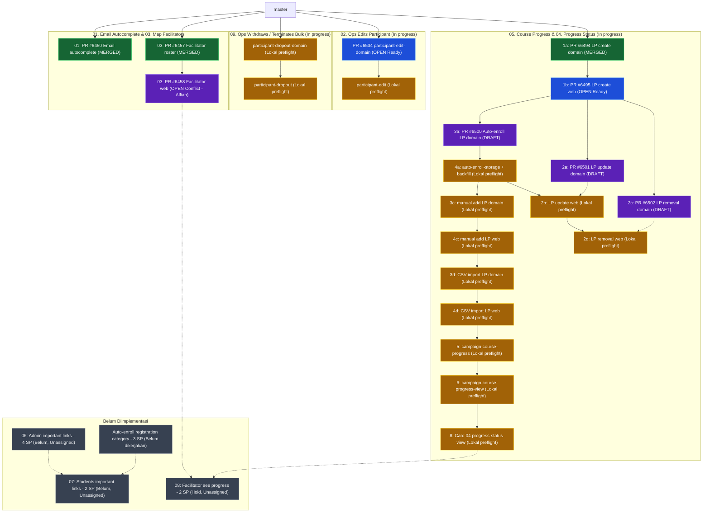

# Revamp APD: Brainstorm SP Card Cycle-2 Krisna

Hasil brainstorm estimasi SP untuk card Revamp APD milik Krisna yang masih di Planning. Lanjutan dari [implementation-backlog.md](../Cycle%201/implementation-backlog.md). Dokumen ini referensi hidup: keputusan boleh diubah, tulis tanggal dan alasannya di kolom keputusan.

## Cara membaca

Dokumen ini index. Detail tiap card ada di folder ini, satu file per card. Cycle 1 ada di [../Cycle 1/implementation-backlog.md](../Cycle%201/implementation-backlog.md). Baca index dulu, lalu buka hanya file card yang dibutuhkan. Keputusan lintas card ditulis di satu file saja (misalnya desain tabel learning path di 05), file lain cukup me-link ke sana.

## Aturan estimasi

- 1 SP kira-kira 3 jam, 2 SP kira-kira 1 hari kerja. Card di atas 7-8 SP dipecah.
- SP menghitung waktu coding dan waktu memperbaiki hasil review. Lama menunggu review tidak dihitung.
- Kalibrasi dari card sebelumnya (hari dengan commit, termasuk review dan rebase): card [3] add participants 3 SP selesai sekitar 5 hari, card [4] map Lecturers 4 SP selesai sekitar 8 hari (9 PR). Estimasi lama terlalu kecil, jadi pecah card yang lintas domain + web + CSV.
- Skala Krisna lebih kecil dari hitungan jam Claude: autocomplete yang dihitung sekitar 5,5 jam disepakati 1 SP.

## Ringkasan

| Card | SP | Status brainstorm | Detail |
| --- | --- | --- | --- |
| [Email autocomplete in the add-participant form](https://app.basecamp.com/5135326/buckets/44666023/card_tables/cards/10493257720) | 1 | Selesai. PR [#6450](https://github.com/dicoding-dev/dicoding/pull/6450) merged (2026-11-25), card di Confirmation | [01-email-autocomplete](01-email-autocomplete.md) |
| [Ops edits a campaign participant](https://app.basecamp.com/5135326/buckets/44666023/card_tables/cards/10493257711) | 4 | In progress. PR [#6534](https://github.com/dicoding-dev/dicoding/pull/6534) (domain) open; PR web lokal (menunggu merge domain & ack). Withdraw/Terminated dipisah ke [09](09-ops-withdraws-terminates-participants.md) | [02-ops-edits-participant](02-ops-edits-participant.md) |
| [Ops withdraws or terminates campaign participants in bulk](https://app.basecamp.com/5135326/buckets/44666023/card_tables/cards/10545178127) | 4 | In progress. Dipisah dari [02](02-ops-edits-participant.md). PR domain & web selesai lokal dan lolos preflight (menunggu ack/push) | [09-ops-withdraws-terminates-participants](09-ops-withdraws-terminates-participants.md) |
| [Map Facilitators to the groups they accompany](https://app.basecamp.com/5135326/buckets/44666023/card_tables/cards/10411894512) | 2 | In Review. PR [#6457](https://github.com/dicoding-dev/dicoding/pull/6457) merged, lanjutan PR [#6458](https://github.com/dicoding-dev/dicoding/pull/6458) akan dikerjakan Alfian | [03-map-facilitators](03-map-facilitators.md) |
| [Ops manages Students' progress status](https://app.basecamp.com/5135326/buckets/44666023/card_tables/cards/10493257815) | 2 | Selesai. Kalkulasi otomatis. Kolom status dan course "x/y lulus" di daftar peserta admin. AC card perlu ditulis ulang | [04-progress-status](04-progress-status.md) |
| [Course progress is calculated automatically from Dicoding learning data](https://app.basecamp.com/5135326/buckets/44666023/card_tables/cards/10493257784) | 5 (ditetapkan Krisna) | Selesai. Setup learning path dan course, `learning_path_id` peserta, pemetaan auto-enroll termasuk TODO kategori [6], NEED RENEW, dan freeze. Estimasi Claude 5,5 (lihat [bagian 5](05-course-progress.md)). Dikerjakan paling awal | [05-course-progress](05-course-progress.md) |
| [Facilitator see the progress of their supervised Students](https://app.basecamp.com/5135326/buckets/44666023/card_tables/cards/10493257765) | 2 (draft) | Di-hold sampai semua dependensi selesai (P16-P19). SP belum diisi di judul card | [08-facilitator-progress](08-facilitator-progress.md) |
| [Admin manages important links](https://app.basecamp.com/5135326/buckets/44666023/card_tables/cards/10493257862) | 4 | Selesai | [06-admin-important-links](06-admin-important-links.md) |
| [Students see important links](https://app.basecamp.com/5135326/buckets/44666023/card_tables/cards/10493257869) | 2 | Selesai. Terblokir kerangka halaman Student (card Hasbi) dan TODO kategori (masuk card Course progress) | [07-students-important-links](07-students-important-links.md) |
| **Total** | **22** | Termasuk card Fasilitator (draft) |  |

SP di judul card Basecamp sudah disamakan dengan tabel ini (2026-11-18), kecuali card Fasilitator yang belum diisi.

## Peta Stack & Status Card (2026-11-27)

Legenda warna: **Hijau** = Merged ke `master` · **Biru** = PR Open (Ready) · **Ungu** = PR Draft / Hand-off · **Kuning** = Implemented lokal & lolos preflight (belum PR) · **Abu-abu** = Belum diimplementasi.

Buka versi interaktif (fullscreen / zoom bebas): [[Cycle 2 Stack Map.canvas]]

### Perubahan assignee (2026-11-17)

- Krisna sempat mengambil card progress status dan melepas [Facilitator see the progress of their supervised Students](https://app.basecamp.com/5135326/buckets/44666023/card_tables/cards/10493257765). Belakangan card Fasilitator **kembali ke Krisna**, jadi Krisna memegang keduanya (8 card aktif Cycle-2, ditambah Map Lecturers In Review).
- Kolom per 2026-11-18: semua card Cycle-2 Krisna di Exploring, kecuali card Fasilitator yang masih di Planning. Map Lecturers di In Review.
- Ketergantungan card Fasilitator yang masih terbuka: [Students see their learning progress in APD](https://app.basecamp.com/5135326/buckets/44666023/card_tables/cards/10493257746) dan [Ops manages Students' attendance data](https://app.basecamp.com/5135326/buckets/44666023/card_tables/cards/10493257792), keduanya belum ada assignee. Detail Student di view Fasilitator memakai komponen tampilan Student, jadi card tampilan Student sebaiknya dipegang Krisna juga atau dikerjakan lebih dulu.
- Sumber data card Fasilitator sebagian besar milik Krisna sendiri: course progress ([bagian 5](05-course-progress.md)), status ([bagian 4](04-progress-status.md)), dan mapping Fasilitator (C4, C8).

### Keputusan yang menunggu jawaban

Diperbarui 2026-11-18.

| # | Pertanyaan | Bagian | Status |
| --- | --- | --- | --- |
| Q1 | Definisi LB | 4 | ✅ Rumus Ops cukup |
| Q2 | Kelas yang dihitung lulus | 4, 5 | ✅ Course learning path program yang selesai atau di-renew dalam periode |
| Q3 | Status di luar periode | 4 | ✅ Dibekukan setelah `close_at`. Progress sebelum program hanya terhitung kalau < 100% |
| Q4 | Peserta yang dikeluarkan di daftar admin dan Fasilitator | 2, 4, 8 | ✅ Tetap tampil, label "Inactive" |
| Q5 | Filter periode dan NEED RENEW | 5 | ✅ Masuk card Course progress |
| Q6 | Pengakhiran token MCT | 2 | ✅ Dropout penuh. "ENDED saja" tidak mencabut akses kelas |
| Q7 | Pecah card Course progress? | 5 | ✅ Tidak dipecah, SP 5 |
| Q8 | Membedakan Withdraw dan Terminated | 2 | ✅ Kolom `exit_reason`, tanpa fitur pulihkan |
| P2 | Field registrasi free text | 2 | ✅ Tafsiran B. **Daftar field final diputuskan bersama tim** |
| P3 | Program User ID di CSV import | 2 | ✅ Boleh menimpa |
| P4 | `close_at` diedit tidak mengubah `accessible_until` | 2 | Ditunda, di luar card |
| G7 | TODO kategori card [6] | 7 | ✅ Ikut card Course progress |
| G8 | Saklar fitur important links | 7 | ✅ Cukup `importantLinks` |
| P16-P19 | Pertanyaan card Fasilitator | 8 | Ditunda |

**Untuk diskusi tim dan koordinasi:**
- P2: field yang bisa diedit di card Ops edits.
- P4: ke Ops.
- K20 gugur: infokan ke Hasbi.
- Minggu acuan dihitung otomatis dari `open_at`: infokan ke Ops.
- Konfirmasi ke Ops bahwa token "ended" saat withdraw/terminated = halaman dropout MCT.
- Apakah ada kasus Student pindah learning path di tengah program (komentar Krisna di card Ops edits)?

**AC card yang belum sesuai keputusan:** Progress status, Course progress, Ops edits, Students see important links (G8), dan Map Facilitators (C4 dipindah ke card Fasilitator).

Keputusan lain 2026-11-18: K20 gugur. Learning path disimpan di tabel baru per campaign, dan `learning_path_id` disimpan di access list. Setup course memakai combobox tanpa kolom `order`. Detail di [02](02-ops-edits-participant.md) dan [05](05-course-progress.md).

### Peta dependensi (2026-11-18)

Pembaruan assignee: [Students see their learning progress in APD](https://app.basecamp.com/5135326/buckets/44666023/card_tables/cards/10493257746) dan [Ops manages Students' attendance data](https://app.basecamp.com/5135326/buckets/44666023/card_tables/cards/10493257792) sekarang dipegang **Hasbi** (sebelumnya tanpa assignee). Keduanya masih di Planning.

| Card Krisna | Bergantung ke | Pemilik | Status | Sifat |
| --- | --- | --- | --- | --- |
| Email autocomplete (1) | - | - | - | Mandiri. Form tambah peserta (card [3]) sudah Done |
| Map Facilitators (2) | - | - | - | Mandiri. `ContributorCreation` sudah ada di master, jadi Fasilitator sudah bisa ditambahkan ke campaign walaupun card Alfian (10411894097) masih In progress. Kabari Alfian karena filter role di kode grup miliknya diubah. Koordinasi C3 dengan schedule Ikhlas |
| Course progress (5) | - | - | - | Mandiri. Card [6] (auto-register) dan kategori campaign sudah Done. Card ini jadi blocker card lain |
| Admin manages important links (4) | - | - | - | Mandiri. Pengaturan campaign dan kategori sudah Done |
| Ops edits participant (4) | - | - | - | Mandiri sejak 2026-11-19: learning path tidak diedit, jadi tidak bergantung ke Course progress |
| Progress status (2) | Course progress | Krisna | Exploring | Blocker milik sendiri (tabel learning path, `target_week`, query kelulusan) |
| Students see important links (2) | [User can Access APD based on their Role](https://app.basecamp.com/5135326/buckets/44666023/card_tables/cards/10411894672) | Hasbi | Planning | Blocker (kerangka halaman Student/Fasilitator) |
| | Admin manages important links | Krisna | Exploring | Blocker milik sendiri |
| | Course progress (TODO kategori [6]) | Krisna | Exploring | Blocker untuk Student auto-register |
| | Pembaca saklar fitur campaign | Belum jelas (kemungkinan Hasbi) | Belum ada | Koordinasi |
| Facilitator see progress (2, hold) | User can Access APD based on their Role (10411894672) | Hasbi | Planning | Blocker |
| | Students see their learning progress in APD (10493257746) | Hasbi | Planning | Blocker (komponen detail) |
| | Map Facilitators, Course progress, Progress status | Krisna | Exploring | Blocker milik sendiri |
| | [Ops manages Students' attendance data](https://app.basecamp.com/5135326/buckets/44666023/card_tables/cards/10493257792) | Hasbi | Planning | Isi detail |
| | [Ops manages Students' assignment data](https://app.basecamp.com/5135326/buckets/44666023/card_tables/cards/10493257805) | Alfian | Exploring | Isi detail |
| | [Ops manages point histories from the campaign admin](https://app.basecamp.com/5135326/buckets/44666023/card_tables/cards/10493257825) | Alfian | Exploring | Isi detail |

Urutan kerja: (1) card mandiri: Course progress, Email autocomplete, Map Facilitators, Admin important links, Ops edits. (2) Progress status setelah Course progress. (3) Students see important links setelah kerangka Hasbi ada. (4) Card Fasilitator paling akhir.

## Pembaruan dari komentar card (dibaca ulang 2026-11-23)

Komentar terakhir di semua card adalah 2026-11-19. Yang mengubah catatan:

| Card | Perubahan | Detail |
| --- | --- | --- |
| Ops edits participant | Learning path tidak diedit, jadi **tidak bergantung ke Course progress**. Program User ID tidak boleh diubah (meeting dengan Ops), jadi P3 batal. Field free text registrasi (Jurusan, NIM, institusi, prodi) ikut diedit. SP perlu dihitung ulang | [02](02-ops-edits-participant.md#keputusan-2026-11-19-komentar-card-dan-meeting-ops) |
| Course progress, Progress status | Course per learning path diambil dari MCT berdasarkan `program_id`, lalu Ops menentukan course per minggu | [05](05-course-progress.md#keputusan-2026-11-19-course-diambil-dari-mct-komentar-card-progress-status), [04](04-progress-status.md) |
| Admin important links | Satu tabel, kategori/topik pakai combobox. Tabel grup gugur, SP perlu dicek ulang | [06](06-admin-important-links.md#keputusan-2026-11-19-satu-tabel-kategori-pakai-combobox) |
| Email autocomplete, Map Facilitators, Facilitator progress, Students important links | Tidak ada komentar baru | - |
