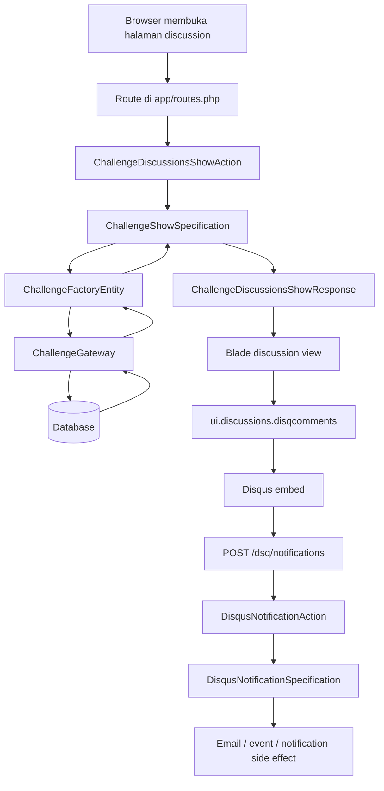
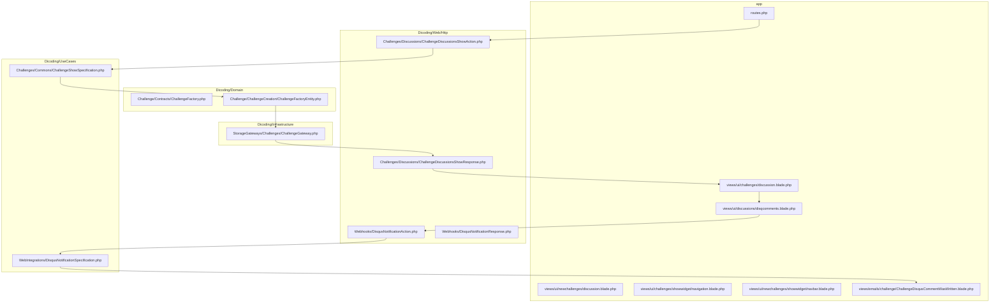

# Academy & Challenge Discussion Guide

Dokumen ini menjelaskan fitur discussion (akademi dan challenge) di Dicoding secara end-to-end, dimulai dari behavior user, route, alur eksekusi kode, sampai cara mereplikasi pola implementasinya untuk fitur baru.

**Catatan Penting**: Dokumentasi ini mencakup TWO model diskusi berbeda:
1. **Academy Discussions** - Internal database-driven discussions dengan permission control di `CourseDiscussionPermissionHelper`
2. **Challenge Discussions** - Disqus-integrated discussions dengan SSO dan webhook notifications

Fokus utama adalah **Academy Discussions** karena merepresentasikan pola DDD Dicoding yang lebih kompleks.

## 1. Gambaran Singkat

### 1.1 Academy Discussions (FOKUS UTAMA)

Academy discussions adalah internal forum berbasis database di halaman akademi/kelas.

Pola:
`Route -> Web Action -> QueryRepository -> Domain Service (Permission) -> View Model -> Response -> Blade View`

Karakteristik:
- Data diskusi disimpan di database internal (tabel `academy_discussions`, `discussion_comments`)
- Akses dikontrol via `CourseDiscussionPermissionHelper` (domain service)
- View Model (`AcademyDiscussionVM`, `AcademyDiscussionShowVM`) membangun presentasi data
- Tidak bergantung pada Disqus (pure internal)
- Endpoint: `academies/{id}/discussions` dan `academies/{id}/discussions/{discussionId}`

### 1.2 Challenge Discussions (REFERENCE)

Challenge discussions adalah forum berbasis Disqus dengan SSO dan webhook.

Pola:
`Route -> Web Action -> UseCase Specification -> Domain Factory -> Infrastructure Gateway -> Response -> Blade View -> Disqus`

Karakteristik:
- Komentar tersimpan di Disqus (eksternal)
- Identifier unik: `disqus_identifier` (format: `challenge_{id}`)
- SSO via `remote_auth_s3`
- Callback webhook untuk notifikasi email
- Endpoint: `challenges/{id}/discussions` dengan optional `commentId` untuk deep linking

## 2. Behavior User - Academy Discussions

### 2.1 User yang melihat halaman academy discussions
- User membuka halaman akademi/kelas terlebih dahulu.
- Pada halaman kelas, tab "Diskusi" muncul jika user memiliki akses.
- Akses ditentukan oleh `CourseDiscussionPermissionHelper::canOpen()` yang mengecek:
  - User sudah login (authenticated)
  - User punya enrollment atau role tertentu
  - Study progress user memenuhi syarat

### 2.2 User authenticated + enrollment valid
- User dapat membaca daftar diskusi untuk kelas tersebut.
- User dapat membuat diskusi baru (jika `canManage()` true atau `canOpen()` true).
- User dapat melihat detail diskusi individual beserta comment thread.
- Status diskusi: `draft`, `published`, `closed`.
- User non-manager hanya melihat diskusi `published`.

### 2.3 User yang membuat diskusi
- Request dikirim via POST ke `academies/{id}/discussions`.
- Specification/Action memvalidasi input dan membuat record di `academy_discussions` table.
- Diskusi baru default status `draft` atau `published` tergantung permission user.

### 2.4 User membaca/menulis comment
- Comment disimpan di `discussion_comments` table.
- Thread: root comments + nested replies.
- User bisa vote comment (helpful/unhelpful).
- Instructor/admin bisa mark comment sebagai "answer" (selected answer).

### 2.5 User yang bukan manager atau belum enroll
- Tidak bisa akses tab diskusi.
- Jika mencoba akses langsung: redirect atau error 403.
- Halaman menampilkan pesan: "Anda tidak memiliki izin untuk mengakses diskusi ini!"

## 2B. Behavior User - Challenge Discussions (Reference)

### 2B.1 User authenticated + challenge valid
- User dapat membuka halaman challenge discussion.
- Tab "Pembahasan" muncul di navigation.
- Disqus widget aktif dengan authenticated user context.
- User bisa membaca dan menulis komentar langsung di Disqus.

### 2B.2 Saat user menulis komentar challenge
- Komentar dikirim ke Disqus, bukan tabel lokal.
- Callback webhook ke `/dsq/notifications` untuk side effect (email notification).
- Endpoint notifikasi memvalidasi payload dan trigger domain event atau mailer.

### 2B.3 Saat user membuka link komentar langsung
- URL discussion mendukung parameter `commentId`.
- Deep link untuk direct access dari email: `challenges/{id}/discussions?commentId=xyz`.


## 3. Peta File Utama

### 3.1 Routes
- `app/routes.php` - Untuk kedua jenis discussion (academy dan challenge)

**Academy Routes:**
```
GET  /academies/{id}/discussions              -> AcademyDiscussionIndexAction
GET  /academies/{id}/discussions/{discussionId} -> AcademyDiscussionShowAction
POST /academies/{course_id}/discussions       -> AcademyDiscussionStoreAction
GET  /academies/{id}/discussions/{discussionId}/edit -> AcademyDiscussionEditAction
PUT  /academies/{id}/discussions/{discussionId}     -> AcademyDiscussionUpdateAction
```

**Challenge Routes:**
```
GET  /challenges/{id}/discussions{commentId} -> ChallengeDiscussionsShowAction
POST /dsq/notifications                      -> DisqusNotificationAction
```

### 3.2 Web Layer - Academy Discussions
- `Dicoding/Web/Http/Academies/Discussion/AcademyDiscussionIndexAction.php`
- `Dicoding/Web/Http/Academies/Discussion/AcademyDiscussionShowAction.php`
- `Dicoding/Web/Http/Academies/Discussion/AcademyDiscussionStoreAction.php`
- `Dicoding/Web/Http/Academies/Discussion/AcademyDiscussionCreateAction.php`
- `Dicoding/Web/Http/Academies/Discussion/AcademyDiscussionEditAction.php`
- `Dicoding/Web/Http/Academies/Discussion/AcademyDiscussionUpdateAction.php`
- `Dicoding/Web/Http/Academies/Discussion/AcademyDiscussionIndexResponse.php`
- `Dicoding/Web/Http/Academies/Discussion/AcademyDiscussionShowResponse.php`
- `Dicoding/Web/Http/Academies/Discussion/AcademyDiscussionStoreResponse.php`
- (... dan response classes lainnya untuk edit, update, pin, resolve, state, dll)

### 3.3 Web Layer - Challenge Discussions
- `Dicoding/Web/Http/Challenges/Discussions/ChallengeDiscussionsShowAction.php`
- `Dicoding/Web/Http/Challenges/Discussions/ChallengeDiscussionsShowResponse.php`
- `Dicoding/Web/Http/Webhooks/DisqusNotificationAction.php`
- `Dicoding/Web/Http/Webhooks/DisqusNotificationResponse.php`

### 3.4 QueryRepository Layer
- `Dicoding/Infrastructure/QueryRepositories/Academies/AcademyPageQueryRepository.php` - Untuk academy discussions VM building
  - Method: `constructDiscussionVM()`, `constructDiscussionShowVM()`, `constructDiscussionVMWithExistingStudentOnCourseVM()`

### 3.5 Domain Services (Academy)
- `Dicoding/DomainServices/CourseDiscussionPermission/CourseDiscussionPermissionHelper.php`
  - Method: `canOpen()`, `canManage()` - Permission control untuk academy discussions

### 3.6 UseCase Specifications (Academy)
- `Dicoding/UseCases/Academies/AcademyDiscussions/` - Folder untuk academy discussion specifications
  - `AcademyDiscussionBotFeedbackStoreSpecification.php` - Untuk feedback AI pada discussion

### 3.7 UseCase Specifications (Challenge)
- `Dicoding/UseCases/Challenges/Commons/ChallengeShowSpecification.php`
- `Dicoding/UseCases/WebIntegrations/DisqusNotificationSpecification.php`

### 3.8 Infrastructure Layer - Academy Discussions
- `Dicoding/Infrastructure/StorageGateways/Academies/Discussions/AcademyDiscussionGateway.php`
  - Method: `findById()`, `getDiscussionsForCourse()`, `getPopularKeywordsOnCourse()`, dll
- `Dicoding/Infrastructure/StorageGateways/Academies/Discussions/DiscussionCommentGateway.php`
  - Method: `getDiscussionCommentCount()`, `getParentComments()`, dll

### 3.9 Infrastructure Layer - Challenge Discussions
- `Dicoding/Infrastructure/StorageGateways/Challenges/ChallengeGateway.php`
- `Dicoding/Infrastructure/WebServices/Disqus/DisqusApiService.php` - Service untuk API Disqus

### 3.10 View Models (Academy)
- `Dicoding/Web/VM/Academies/Index/AcademyDiscussionVM.php`
- `Dicoding/Web/VM/Academies/Discussion/AcademyDiscussionShowVM.php`
- `Dicoding/Web/VM/Academies/Discussion/AcademyDiscussionEditVM.php`

### 3.11 Views - Academy Discussions
- `app/views/ui/v3/discussions/index.blade.php` - New UI list discussions
- `app/views/ui/newacademies/discussions/index.blade.php` - Old UI list discussions
- `app/views/ui/v3/discussions/show.blade.php` - New UI single discussion detail
- `app/views/ui/discussions/disqcomments.blade.php` - Partial untuk comments (reusable)

### 3.12 Views - Challenge Discussions
- `app/views/ui/challenges/discussion.blade.php`
- `app/views/ui/newchallenges/discussion.blade.php`
- `app/views/ui/discussions/disqcomments.blade.php` - Partial Disqus widget
- `app/views/ui/challenges/showwidget/navigation.blade.php`
- `app/views/ui/newchallenges/showwidget/navbar.blade.php`

## 3.7 File Tree Replikasi Kode

Kalau Anda ingin mereplikasi fitur discussion dengan pola yang sama, susunan file yang biasanya dibuat atau disesuaikan adalah seperti ini:

```text
app/
├── routes.php
├── views/
│   ├── ui/
│   │   ├── challenges/
│   │   │   ├── discussion.blade.php
│   │   │   └── showwidget/
│   │   │       └── navigation.blade.php
│   │   ├── newchallenges/
│   │   │   ├── discussion.blade.php
│   │   │   └── showwidget/
│   │   │       └── navbar.blade.php
│   │   └── discussions/
│   │       └── disqcomments.blade.php
│   └── emails/
│       └── challenge/
│           └── ChallengeDisqusCommentWasWritten.blade.php

Dicoding/
├── Web/
│   ├── Http/
│   │   ├── Challenges/
│   │   │   └── Discussions/
│   │   │       ├── ChallengeDiscussionsShowAction.php
│   │   │       └── ChallengeDiscussionsShowResponse.php
│   │   └── Webhooks/
│   │       ├── DisqusNotificationAction.php
│   │       └── DisqusNotificationResponse.php
│   └── ...
├── UseCases/
│   ├── Challenges/
│   │   └── Commons/
│   │       └── ChallengeShowSpecification.php
│   └── WebIntegrations/
│       └── DisqusNotificationSpecification.php
├── Domain/
│   └── Challenge/
│       ├── Contracts/
│       │   └── ChallengeFactory.php
│       └── ChallengeCreation/
│           └── ChallengeFactoryEntity.php
└── Infrastructure/
    └── StorageGateways/
        └── Challenges/
            └── ChallengeGateway.php
```

Urutan ini penting karena proses replikasi biasanya paling mudah jika mengikuti aliran file dari atas ke bawah: route dulu, lalu Action, lalu UseCase, lalu Domain/Infrastructure, lalu Response, dan terakhir View.

## 4. Flow End-to-End Academy Discussions (FOKUS UTAMA)

### 4.1 Academy Discussion - List (GET /academies/{id}/discussions)

#### Step 1: Request masuk ke route
```php
Route::get('academies/{id}/discussions', [
    'as' => 'academies.discussions.index',
    'uses' => AcademyDiscussionIndexAction::class,
]);
```

Makna penting:
- `id` adalah course id.
- Route diproteksi dengan middleware auth (hanya user login).

#### Step 2: Action menerima request
Action hanya HTTP concern:
```php
public function __invoke(int $courseId): PayloadInterface {
    // - Validasi course exist
    // - Cek permission via CourseManagerPermissionService::canOpenCourse()
    // - Build payload data
    // - Return payload
}
```

#### Step 3: QueryRepository membangun VM
```php
$discussionVM = $this->academyPageRepository
    ->constructDiscussionVMWithExistingStudentOnCourseVM(
        $vm,
        $this->userRoleHelper,
        $parameters
    );
```

Repository method:
- Mengecek `canManage()` dan `canOpen()` via `CourseDiscussionPermissionHelper`
- Mengambil discussions dari `AcademyDiscussionGateway::getDiscussionsForNewUI()`
- Mengambil tutorial list dan popular keywords
- Return `AcademyDiscussionVM` (bukan specification, langsung VM)

#### Step 4: Domain Service Permission Control
`CourseDiscussionPermissionHelper`:
- `canOpen($courseId, $userRoleHelper, $studyProgress)` - Apakah user bisa baca discussion?
  - Check: user authenticated, enrollment valid, atau admin
- `canManage($courseId, $userRoleHelper)` - Apakah user bisa manage (edit/delete) discussion?
  - Check: user adalah instructor, admin, atau course owner

#### Step 5: Gateway Query Database
`AcademyDiscussionGateway`:
```php
public function getDiscussionsForNewUI($filters, $isUserCanManageDiscussion, $courseId) {
    // Query discussion dengan filter:
    // - If manager: semua status (draft, published, closed)
    // - If member: hanya published
    // - Apply search/filter dari user
}
```

#### Step 6: Response memilih view
```php
if (Feature::isEnabled('classroom_v3.0')) {
    return $this->factory->make('ui.v3.discussions.index', $payload->getOutput());
}
return $this->factory->make('ui.newacademies.discussions.index', $payload->getOutput());
```

#### Step 7: Blade view merender list
`ui.v3.discussions.index.blade.php`:
- Include header dengan course info
- Include navigation/tab discussions
- If `canOpenDiscussion()`: render main discussion list dengan filters, search, keywords
- Else: tampil pesan "Anda tidak memiliki izin"

#### Step 8: Frontend rendering & interaction
- JavaScript untuk search/filter discussions
- Pagination
- Click discussion untuk navigate ke detail

### 4.2 Academy Discussion - Detail (GET /academies/{id}/discussions/{discussionId})

#### Flow serupa dengan index, tapi action tambahan:
```php
public function __invoke(int $courseId, int $discussionId): PayloadInterface {
    // - Get course
    // - Construct StudentOnCourseVM
    // - Construct DiscussionShowVM via repository
    // - If discussionVM->maybeShowDisqusComment(): close thread
    // - Return payload dengan discussionVM, comments, selectedAnswer
}
```

#### QueryRepository method:
```php
public function constructDiscussionShowVM(
    UserRoleHelper $userRoleHelper,
    object $course,
    int $discussionId
): AcademyDiscussionShowVM {
    // - Get discussion via gateway
    // - Check permission: canOpen($courseId, $userRoleHelper, $studyProgress, $discussion->status)
    // - Throw AuthenticationException jika tidak boleh akses
    // - Return AcademyDiscussionShowVM
}
```

#### View (ui.v3.discussions/show.blade.php):
- Show discussion detail (title, description, creator, created_at, status)
- Show comment thread (parent + nested replies)
- If canManage: show action buttons (edit, delete, pin, resolve, mark as answer)
- If user enrolled: show comment form untuk reply
- Pagination untuk comments

---

## 4B. Flow End-to-End Challenge Discussions (REFERENCE)

### 4B.1 Step 1: Request masuk ke route
Route discussion challenge didefinisikan seperti ini:

```php
Route::get('challenges/{id}/discussions{commentId}', [
    'as' => 'challenges.discussions',
    'uses' => 'Dicoding\\Web\\Http\\Challenges\\Discussions\\ChallengeDiscussionsShowAction@action',
])->where('commentId', '.*');
```

Makna penting:
- `id` adalah challenge id.
- `commentId` opsional dan bisa kosong.
- Route name `challenges.discussions` dipakai di view, email, dan navigation.

### 4B.2 Step 2: Action menerima request
Action adalah lapisan tipis.

Tanggung jawabnya:
- Menerima `id` dari route.
- Mengambil `visitor_xp` dari user login.
- Menjalankan specification.

Contoh logika:

```php
return $this->useCase->run($this->challengeShowSpecification, [
    'challenge_id' => $id,
    'visitor_xp' => (int) \Auth::user()->xp->value
]);
```

Hal yang tidak dilakukan Action:
- Tidak query database.
- Tidak membuat business decision.
- Tidak render view.

### 4.3 Step 3: UseCase Specification mengatur flow
Specification ini dipakai juga oleh challenge show, jadi discussion challenge memakai use case yang sama dengan challenge main page.

Tugas utama specification:
- Validasi input.
- Menentukan flow authenticated atau unauthenticated.
- Mengambil challenge via factory.
- Mengecek status challenge.
- Mengisi payload output.

Bagian penting di flow authenticated:
- `challenge` diambil dari `ChallengeFactory`.
- `winningAppsAmount` dihitung lewat repository.
- `followers` dihitung dari gateway.
- `can_see` menentukan apakah user boleh melihat detail tertentu.
- `disqus_identifier` di-set sebagai `challenge_{id}`.
- `canonical_link` diisi ke URL challenge utama.

### 4.4 Step 4: Domain Factory membentuk entity
`ChallengeFactoryEntity` bertugas mengubah data mentah dari database menjadi object domain `Challenge`.

Alurnya:
- Factory memanggil `ChallengeGateway->findById($id)`.
- Jika challenge tidak ada, lempar `ObjectNotFoundException`.
- Factory membangun challenge object beserta platform dan fitur.

Kenapa penting:
- Domain tidak tahu SQL.
- Domain bekerja dengan object bisnis, bukan array mentah.

### 4.5 Step 5: Infrastructure Gateway melakukan query
`ChallengeGateway` adalah lokasi SQL nyata.

Contoh tanggung jawabnya:
- `findById($id)` untuk mengambil detail challenge.
- `getChallengeFollowersAmmount($challengeId)` untuk menghitung followers.
- Query ke tabel `challenges`, `users`, `challenge_platforms`, `challenge_features`, dan tabel lain yang relevan.

Sesuai guideline Dicoding:
- Semua sink database ada di Infrastructure.
- Layer ini harus diaudit untuk SQL injection, SSRF, dan risiko sink lain.

### 4.6 Step 6: Response memilih view
Response class mengubah payload menjadi response HTTP.

Perilakunya:
- Jika payload sukses, render view discussion.
- Jika gagal, redirect ke `challenges.index` dan kirim warning message.
- Feature flag `new_ui` menentukan apakah view lama atau view baru yang dipakai.

Jadi ada dua kemungkinan view:
- `ui.challenges.discussion`
- `ui.newchallenges.discussion`

### 4.7 Step 7: Blade view menampilkan halaman
View discussion challenge bersifat presentation-only.

Yang tampil di halaman:
- Header challenge.
- Info challenge.
- Navigation/tab challenge.
- Judul section `Pembahasan`.
- Partial Disqus comments.

View tidak melakukan business logic berat.

### 4.8 Step 8: Disqus widget di-embed
Partial `ui.discussions.disqcomments` adalah inti interaksi komentar.

Fungsi partial ini:
- Membuat `disqus_identifier`.
- Mengirim `remote_auth_s3` untuk SSO Disqus.
- Mengirim `api_key` publik Disqus.
- Mengirim `page.url` dan `page.identifier`.
- Menyediakan callback ketika komentar baru ditulis.

Callback itu akan memanggil:
- `POST /dsq/notifications`

### 4.9 Step 9: Notifikasi komentar diproses
Endpoint internal notifikasi Disqus menerima data komentar.

Flow-nya:
- Action webhook menerima request.
- Specification memvalidasi data notifikasi.
- Mailer lama tetap dijalankan untuk kompatibilitas.
- Jika feature flag aktif, system dapat memicu event domain tambahan.

### 4.10 Step 10: Email deep link ke komentar
Template email challenge discussion menyediakan link langsung ke halaman discussion dengan `commentId`.

Artinya:
- Pengguna bisa langsung diarahkan ke komentar tertentu.
- Fitur ini penting untuk notifikasi follow-up.

## 5. Behavior Berdasarkan Kondisi User

### 5A. Academy Discussions - Behavior Conditions

#### 5A.1 User authenticated + enrollment valid + canOpen() = true
Hasil:
- Halaman discussion list tampil.
- User bisa membaca discussions (hanya published jika bukan manager).
- User bisa membuat discussion baru (jika canManage() true).
- User bisa reply/comment di discussion.

Path yang terlibat:
- `app/routes.php`
- `Dicoding/Web/Http/Academies/Discussion/AcademyDiscussionIndexAction.php`
- `Dicoding/Infrastructure/QueryRepositories/Academies/AcademyPageQueryRepository.php`
- `Dicoding/DomainServices/CourseDiscussionPermission/CourseDiscussionPermissionHelper.php`
- `Dicoding/Web/Http/Academies/Discussion/AcademyDiscussionIndexResponse.php`
- `app/views/ui/v3/discussions/index.blade.php`

#### 5A.2 User authenticated + enrollment tidak valid + canOpen() = false
Hasil:
- Halaman discussion tampil pesan "Anda tidak memiliki izin untuk mengakses diskusi ini!"
- User tidak bisa membuat atau membaca discussion.
- View render partial `can-not-open-discussion.blade.php`.

Path yang perlu diperiksa:
- `Dicoding/DomainServices/CourseDiscussionPermission/CourseDiscussionPermissionHelper::canOpen()`
- `Dicoding/Web/Http/Academies/Discussion/AcademyDiscussionIndexResponse.php`
- `app/views/ui/v3/discussions/partials/can-not-open-discussion.blade.php`

#### 5A.3 User authenticated + manager role + canManage() = true
Hasil:
- User melihat ALL discussions (draft, published, closed).
- User bisa edit, delete, pin, resolve, atau change status discussion.
- User bisa mark comment sebagai "answer".

Path yang menentukan ini:
- `Dicoding/DomainServices/CourseDiscussionPermission/CourseDiscussionPermissionHelper::canManage()`
- `Dicoding/Web/Http/Academies/Discussion/AcademyDiscussionEditAction.php`
- `app/views/ui/v3/discussions/index.blade.php` (show action buttons)

#### 5A.4 User guest / unauthenticated
Hasil:
- Route discussion dilindungi middleware auth.
- Akses redirect ke login page.
- Discussion tab tidak tampil di course page.

Path yang membentuk perilaku ini:
- `app/routes.php` (auth middleware)
- `app/views/ui/v3/academies/partials/navigation.blade.php` (hide discussion tab)

### 5B. Challenge Discussions - Behavior Conditions (REFERENCE)

#### 5B.1 User authenticated + challenge valid
Hasil:
- Halaman discussion tampil.
- Tab discussion muncul di navigation.
- Disqus widget aktif.
- User bisa membaca dan menulis komentar.

Path yang terlibat:
- `app/routes.php`
- `Dicoding/Web/Http/Challenges/Discussions/ChallengeDiscussionsShowAction.php`
- `Dicoding/UseCases/Challenges/Commons/ChallengeShowSpecification.php`
- `Dicoding/Web/Http/Challenges/Discussions/ChallengeDiscussionsShowResponse.php`
- `app/views/ui/challenges/discussion.blade.php`
- `app/views/ui/discussions/disqcomments.blade.php`

#### 5B.2 User authenticated + challenge tidak tersedia
Hasil:
- Specification bisa melempar `InvariantException`.
- Response akan redirect atau menampilkan warning.

Path yang perlu diperiksa:
- `Dicoding/UseCases/Challenges/Commons/ChallengeShowSpecification.php`
- `Dicoding/Web/Http/Challenges/Discussions/ChallengeDiscussionsShowResponse.php`

#### 5B.3 User authenticated + private challenge + XP tidak cukup
Hasil:
- `can_see` bisa bernilai false.
- UI bisa menyembunyikan tab tertentu atau membatasi akses detail.

Path yang menentukan ini:
- `Dicoding/UseCases/Challenges/Commons/ChallengeShowSpecification.php`
- `app/views/ui/challenges/showwidget/navigation.blade.php`
- `app/views/ui/newchallenges/showwidget/navbar.blade.php`

#### 5B.4 User guest
Hasil:
- Route discussion tidak ditujukan untuk guest.
- Navigation discussion tidak tampil.
- Akses idealnya tidak mencapai halaman discussion.

Path yang membentuk perilaku ini:
- `app/routes.php`
- `app/views/ui/challenges/showwidget/navigation.blade.php`
- `app/views/ui/newchallenges/showwidget/navbar.blade.php`

## 6. Kenapa Flow Ini Berbeda dari Laravel Umum

### 6.1 Academy Discussions Pattern

**Academy Discussions menggunakan:**
- Query Repository untuk VM building (bukan Service Layer)
- Domain Service untuk permission control (`CourseDiscussionPermissionHelper`)
- Direct gateway access (tidak ada specification layer untuk list/show)
- Thin Action layer yang fokus HTTP concern

**Alasan:**
- VM construction lebih focus pada read-side
- Permission logic dikelola oleh domain service yang reusable
- Simpler than challenge pattern untuk internal forum

### 6.2 Challenge Discussions Pattern

**Challenge Discussions menggunakan:**
- UseCase Specification untuk business flow orchestration
- Domain Factory untuk entity building
- Infrastructure Gateway untuk query database
- Disqus integration untuk external comments

**Alasan:**
- Lebih complex: perlu SSO, webhook, external integration
- Specification lebih mudah ditest dan reuse
- Clear separation antara read (gateway) dan write (specification)

### 6.3 Perbedaan dengan Laravel Standar
- Laravel standar: Route -> Controller -> Model -> View
- Dicoding Academy: Route -> Action -> QueryRepository (VM) -> Response -> View
- Dicoding Challenge: Route -> Action -> Specification -> Factory/Gateway -> Response -> View

Perbedaannya terasa terutama pada:
- testability,
- reuse use case,
- separation of concerns,
- permission control clarity,
- dan audit security.

## 7. Cara Replikasi Kode untuk Fitur Discussion Serupa

### 7A. Untuk Discussion Tipe ACADEMY (Internal Forum)

Kalau Anda ingin membuat fitur internal forum/discussion untuk entitas baru:

#### 7A.1 Tambahkan route
Buat route GET untuk discussion list dan detail.

Contoh pola:
- `entity/{id}/discussions` - list discussions
- `entity/{id}/discussions/{discussionId}` - detail discussion
- `entity/{id}/discussions/{discussionId}/edit` - edit discussion

File yang diedit:
- `app/routes.php`

Langkah praktis:
1. Tambahkan route ke section domain yang relevan.
2. Beri route name seperti `entities.discussions.index`, `entities.discussions.show`.
3. Letakkan di route group auth.
4. Tambahkan middleware course manager jika diperlukan.

#### 7A.2 Buat Action tipis
Buat file:
- `Dicoding/Web/Http/{Entity}/Discussion/{Entity}DiscussionIndexAction.php`
- `Dicoding/Web/Http/{Entity}/Discussion/{Entity}DiscussionShowAction.php`

Isi Action hanya:
- Terima parameter dari route
- Cek course/entity exists
- Call QueryRepository untuk VM building
- Return payload

File tree:
```text
Dicoding/Web/Http/{Entity}/Discussion/
├── {Entity}DiscussionIndexAction.php
├── {Entity}DiscussionIndexResponse.php
├── {Entity}DiscussionShowAction.php
├── {Entity}DiscussionShowResponse.php
├── {Entity}DiscussionStoreAction.php
└── {Entity}DiscussionStoreResponse.php
```

Checklist implementasi:
1. Inject QueryRepository, Gateway, dan PermissionService.
2. Tidak ada business rule logic di Action.
3. Gunakan user context (`UserRoleHelper`) untuk permission check.

#### 7A.3 Buat QueryRepository method
Tambahkan method di QueryRepository (atau buat baru):
```php
public function constructDiscussionVM(
    UserRoleHelper $userRoleHelper,
    object $course,
    array $filters = []
): DiscussionVM {
    $permissionHelper = new YourDiscussionPermissionHelper();
    $canManage = $permissionHelper->canManage($course->id, $userRoleHelper);
    $canOpen = $permissionHelper->canOpen($course->id, $userRoleHelper);
    
    $discussions = $this->gateway->getDiscussions($course->id, $canManage, $filters);
    
    return new DiscussionVM($discussions, $canManage, $canOpen);
}
```

File tree:
```text
Dicoding/Infrastructure/QueryRepositories/
├── {Entity}/
│   └── {Entity}PageQueryRepository.php
```

Checklist implementasi:
1. Tentukan permission helper (buat atau reuse).
2. Call gateway untuk fetch discussions.
3. Build VM dengan data yang sudah difilter permission.

#### 7A.4 Buat Permission Helper
Buat domain service untuk permission logic:
```php
class {Entity}DiscussionPermissionHelper {
    public function canOpen($entityId, UserRoleHelper $userRoleHelper) { }
    public function canManage($entityId, UserRoleHelper $userRoleHelper) { }
}
```

File tree:
```text
Dicoding/DomainServices/
└── {Entity}DiscussionPermission/
    └── {Entity}DiscussionPermissionHelper.php
```

Checklist implementasi:
1. Implement `canOpen()` dengan logic yang sesuai domain.
2. Implement `canManage()` untuk instructor/admin only.
3. Inject ke QueryRepository.

#### 7A.5 Buat Gateway
```php
class {Entity}DiscussionGateway {
    public function getDiscussions($entityId, $canManageAll, $filters) { }
    public function findById($discussionId) { }
}
```

File tree:
```text
Dicoding/Infrastructure/StorageGateways/
└── {Entity}/
    └── Discussions/
        ├── {Entity}DiscussionGateway.php
        └── {Entity}DiscussionCommentGateway.php
```

Checklist implementasi:
1. Jangan tambah permission logic di gateway (itu di permission helper).
2. Return data mentah dari database.
3. Handle NULL/missing data dengan exception.

#### 7A.6 Buat View Model
```php
class {Entity}DiscussionVM {
    private array $discussions;
    private bool $canManage;
    private bool $canOpen;
}
```

File tree:
```text
Dicoding/Web/VM/
└── {Entity}/
    └── Index/
        └── {Entity}DiscussionVM.php
```

Checklist implementasi:
1. VM hanya untuk data presentation (tidak ada logic).
2. Getter method untuk akses data.
3. Helper method untuk view: `canOpenDiscussion()`, `getDiscussionsList()`, dll.

#### 7A.7 Buat Response class
```php
class {Entity}DiscussionIndexResponse implements Responsable {
    public function with(PayloadInterface $payload) {
        if ($payload->getStatus() !== PayloadStatus::SUCCESS) {
            return redirect/warning...
        }
        return $this->factory->make('ui.v3.{entity}.discussions.index', $payload->getOutput());
    }
}
```

File tree:
```text
Dicoding/Web/Http/{Entity}/Discussion/
└── {Entity}DiscussionIndexResponse.php
```

Checklist implementasi:
1. Periksa payload status.
2. Redirect ke safe page jika gagal.
3. Render view yang sesuai feature flag jika ada.

#### 7A.8 Buat Blade view
```blade.php
@if($discussionVM->canOpenDiscussion())
    @include('ui.v3.{entity}.discussions.partials.main')
@else
    @include('ui.v3.discussions.partials.can-not-open-discussion')
@endif
```

File tree:
```text
app/views/ui/v3/
└── {entity}/discussions/
    ├── index.blade.php
    ├── show.blade.php
    └── partials/
        ├── main.blade.php
        └── can-not-open-discussion.blade.php
```

Checklist implementasi:
1. Pakai `{{{ }}}` untuk escaping output.
2. Include reusable partials (comments list, form, dll).
3. Check permission sebelum render action buttons.

### 7B. Untuk Discussion Tipe CHALLENGE (Disqus-Integrated)

Kalau Anda ingin replika challenge discussions (Disqus + SSO):

#### Follow pattern yang sudah ada di section 7 original document
- Route dengan optional commentId
- UseCase Specification
- Domain Factory
- Infrastructure Gateway
- Response class
- Blade + Disqus partial
- Webhook handler untuk notifications

(Sudah dijelaskan detail di section 7 original document, cukup ikuti pola itu)

## 8. Perbandingan: Academy vs Challenge Discussions

| Aspek | Academy | Challenge |
|-------|---------|-----------|
| **Data Store** | Internal database | Disqus (eksternal) |
| **Architecture** | QueryRepository + DomainService | Specification + Factory |
| **Permission Logic** | `CourseDiscussionPermissionHelper` | `ChallengeShowSpecification` |
| **Comment Features** | Vote, mark answer, pin | Nested replies via Disqus |
| **Integration** | Pure Dicoding | Disqus + SSO + Webhook |
| **Skalabilitas** | Terbatas ke 1 database | Scale via Disqus |
| **Ownership** | Dicoding full control | Dicoding + Disqus |
| **Search/Filter** | Via database query | Via Disqus API |
| **Use Case** | Internal course forum | Public challenge discussion |


- beri route name yang konsisten.
- bila perlu, taruh di route group auth.

File yang diedit:
- `app/routes.php`

Langkah praktis:
1. Tambahkan route ke section domain yang relevan.
2. Berikan nama route seperti `entities.discussions`.
3. Jika perlu validasi akses login, letakkan di group auth/mfa yang sesuai.
4. Tambahkan constraint parameter seperti `->where('commentId', '.*')` bila ingin deep link komentar.

### 7.2 Buat Action tipis
Buat file seperti:
- `Dicoding/Web/Http/{Entity}/Discussions/{Entity}DiscussionsShowAction.php`

Isi Action hanya:
- ambil `id`.
- ambil data konteks user yang diperlukan.
- panggil use case.

File tree yang biasanya dibuat:
```text
Dicoding/Web/Http/{Entity}/Discussions/
├── {Entity}DiscussionsShowAction.php
└── {Entity}DiscussionsShowResponse.php
```

Checklist implementasi:
1. Inject `UseCase`.
2. Inject specification yang dipakai.
3. Jangan taruh query DB atau business rule di Action.
4. Gunakan user context seperlunya, misalnya XP atau role.

### 7.3 Buat Specification
Specification harus menangani:
- validasi input,
- rule bisnis,
- akses/permission,
- komposisi payload output.

Jika fitur memakai komentar/SSO/visibility, letakkan keputusan bisnis di sini, bukan di Action.

File tree yang biasanya terkait:
```text
Dicoding/UseCases/{Domain}/
└── Commons/
    └── {Entity}ShowSpecification.php
```

Checklist implementasi:
1. Buat `protected static $dataValidationRules`.
2. Tentukan branch authenticated vs unauthenticated bila diperlukan.
3. Ambil data melalui factory/repository yang tepat.
4. Bangun output payload dengan key yang dipakai view.
5. Tangani exception dengan payload factory.

### 7.4 Sediakan Domain Factory / Service
Jika data perlu diubah dari DB row menjadi object bisnis:
- buat factory di domain,
- atau service domain jika ada rule bisnis yang lebih kompleks.

File tree contoh:
```text
Dicoding/Domain/{Domain}/
├── Contracts/
│   └── {Entity}Factory.php
└── {Entity}Creation/
    └── {Entity}FactoryEntity.php
```

Checklist implementasi:
1. Definisikan interface factory di `Contracts`.
2. Implementasikan factory di folder domain spesifik.
3. Factory boleh memanggil gateway, tapi jangan berisi SQL.
4. Factory bertugas mengubah data mentah menjadi entity domain.

### 7.5 Buat Gateway di Infrastructure
Semua query database harus ada di Gateway.

Prinsip penting:
- jangan query langsung dari Action,
- jangan query langsung dari Domain.

File tree contoh:
```text
Dicoding/Infrastructure/StorageGateways/{Domain}/
└── {Entity}Gateway.php
```

Checklist implementasi:
1. Tempatkan semua query di sini.
2. Pastikan query memakai binding/parameter aman.
3. Tambahkan cache bila memang ada pola caching di domain tersebut.
4. Jangan mengembalikan view atau payload HTTP dari layer ini.

### 7.6 Buat Response class
Response class menentukan:
- view mana yang dipakai,
- redirect ke mana jika gagal,
- status payload mana yang dianggap sukses.

File tree contoh:
```text
Dicoding/Web/Http/{Entity}/Discussions/
└── {Entity}DiscussionsShowResponse.php
```

Checklist implementasi:
1. Implement `Responsable`.
2. Cek `PayloadStatus::SUCCESS`.
3. Render view yang sesuai feature flag jika ada.
4. Redirect ke halaman aman jika gagal.

### 7.7 Buat Blade view
View hanya merender output.

Jika memakai Disqus:
- set `disqus_identifier`.
- set URL canonical.
- include partial comments.
- siapkan callback notifikasi.

File tree contoh:
```text
app/views/ui/{entity}/
├── discussion.blade.php
└── showwidget/
    └── navigation.blade.php

app/views/ui/discussions/
└── disqcomments.blade.php
```

Checklist implementasi:
1. Pakai `{{{ }}}` untuk output yang harus aman.
2. Include partial yang reusable.
3. Pastikan route name aktif ditandai di navigation.
4. Masukkan identifier yang konsisten untuk Disqus.

### 7.8 Siapkan endpoint notifikasi komentar
Jika ada callback comment webhook:
- route webhook harus tersedia,
- webhook Action harus validasi payload,
- webhook Specification harus menangani efek samping.

File tree contoh:
```text
Dicoding/Web/Http/Webhooks/
├── DisqusNotificationAction.php
└── DisqusNotificationResponse.php

Dicoding/UseCases/WebIntegrations/
└── DisqusNotificationSpecification.php
```

Checklist implementasi:
1. Tambahkan route webhook.
2. Parse payload dari Disqus atau integration partner.
3. Validasi field wajib.
4. Kirim efek samping seperti email atau event domain.
5. Kembalikan JSON sukses/gagal yang jelas.

### 7.9 Tambahkan navigation/tab
Pastikan user bisa menemukan halaman discussion dari navigation challenge.

Gunakan guard seperti:
- authenticated check,
- `can_see`,
- role check bila perlu.

File tree contoh:
```text
app/views/ui/{entity}/showwidget/
└── navigation.blade.php

app/views/ui/new{entity}/showwidget/
└── navbar.blade.php
```

Checklist implementasi:
1. Tambahkan link route discussion.
2. Set active state berdasarkan `Route::currentRouteName()`.
3. Sembunyikan tab jika user tidak boleh melihatnya.
4. Untuk UI baru dan lama, pertahankan pola yang konsisten.

## 8. Urutan Baca Kode yang Disarankan

Kalau Anda ingin benar-benar memahami fitur ini dari kode, baca dengan urutan berikut:

1. `app/routes.php`
2. `Dicoding/Web/Http/Challenges/Discussions/ChallengeDiscussionsShowAction.php`
3. `Dicoding/UseCases/Challenges/Commons/ChallengeShowSpecification.php`
4. `Dicoding/Domain/Challenge/ChallengeCreation/ChallengeFactoryEntity.php`
5. `Dicoding/Infrastructure/StorageGateways/Challenges/ChallengeGateway.php`
6. `Dicoding/Web/Http/Challenges/Discussions/ChallengeDiscussionsShowResponse.php`
7. `app/views/ui/challenges/discussion.blade.php`
8. `app/views/ui/discussions/disqcomments.blade.php`
9. `Dicoding/Web/Http/Webhooks/DisqusNotificationAction.php`
10. `Dicoding/UseCases/WebIntegrations/DisqusNotificationSpecification.php`
11. `app/views/emails/challenge/ChallengeDisqusCommentWasWritten.blade.php`

## 9. Ringkasan Inti

Fitur discussion challenge di Dicoding sebenarnya adalah:
- halaman challenge yang memuat tab Pembahasan,
- discussion widget yang di-embed dengan Disqus,
- integrasi notifikasi komentar via webhook internal,
- dan flow akses yang dikontrol melalui DDD use case, bukan controller biasa.

Kalau Anda memahami urutan:
`route -> action -> specification -> factory/gateway -> response -> blade -> disqus -> notification`

maka Anda sudah memahami pola inti fitur discussion ini.

## 10. Quick Map 1 Halaman

Bagian ini adalah versi paling cepat untuk mengingat alurnya.

### 10.1 Alur besar

```text
Browser
  -> app/routes.php
  -> ChallengeDiscussionsShowAction
  -> ChallengeShowSpecification
  -> ChallengeFactoryEntity
  -> ChallengeGateway
  -> ChallengeDiscussionsShowResponse
  -> discussion.blade.php / newchallenges/discussion.blade.php
  -> disqcomments.blade.php
  -> Disqus
  -> /dsq/notifications
```

### 10.2 File yang paling penting dibaca dulu

1. `app/routes.php`
2. `Dicoding/Web/Http/Challenges/Discussions/ChallengeDiscussionsShowAction.php`
3. `Dicoding/UseCases/Challenges/Commons/ChallengeShowSpecification.php`
4. `Dicoding/Domain/Challenge/ChallengeCreation/ChallengeFactoryEntity.php`
5. `Dicoding/Infrastructure/StorageGateways/Challenges/ChallengeGateway.php`
6. `Dicoding/Web/Http/Challenges/Discussions/ChallengeDiscussionsShowResponse.php`
7. `app/views/ui/challenges/discussion.blade.php`
8. `app/views/ui/discussions/disqcomments.blade.php`
9. `Dicoding/Web/Http/Webhooks/DisqusNotificationAction.php`
10. `Dicoding/UseCases/WebIntegrations/DisqusNotificationSpecification.php`

### 10.3 Behavior user dalam 3 kalimat

- User login membuka challenge lalu klik tab Pembahasan.
- Halaman menampilkan informasi challenge dan widget Disqus.
- Saat komentar dibuat, sistem memanggil webhook notifikasi untuk email dan event internal.

## 11. Diagram Visual

### 11.1 Diagram flow eksekusi



### 11.2 Diagram folder tree replikasi



## 12. Bedah File per File

Bagian ini menjelaskan peran tiap file secara konkret, dari route sampai callback komentar.

### 12.1 `app/routes.php`
Peran:
- Mendefinisikan URL discussion challenge.
- Menentukan nama route `challenges.discussions`.
- Menghubungkan route ke Action.
- Menyediakan route callback notifikasi Disqus.

Yang perlu diperhatikan:
- Constraint `commentId` bisa dipakai untuk deep link.
- Route discussion berada pada area authenticated.

### 12.2 `Dicoding/Web/Http/Challenges/Discussions/ChallengeDiscussionsShowAction.php`
Peran:
- Menjadi entry point HTTP untuk halaman discussion.
- Mengambil `id` dari route.
- Mengambil `visitor_xp` dari user login.
- Memanggil `ChallengeShowSpecification`.

Yang perlu diperhatikan:
- Tidak ada query database.
- Tidak ada business rule.
- Action harus tetap tipis.

### 12.3 `Dicoding/UseCases/Challenges/Commons/ChallengeShowSpecification.php`
Peran:
- Mengatur business flow untuk challenge show/discussion.
- Memvalidasi data input.
- Menentukan akses authenticated atau unauthenticated.
- Mengisi output payload yang akan dipakai view.

Yang perlu diperhatikan:
- `can_see` dan status challenge.
- `disqus_identifier`.
- `canonical_link`.
- Exception handling lewat payload factory.

### 12.4 `Dicoding/Domain/Challenge/ChallengeCreation/ChallengeFactoryEntity.php`
Peran:
- Mengubah data challenge mentah menjadi object domain `Challenge`.
- Mengisi platform, fitur, owner, dan verifier jika dibutuhkan.

Yang perlu diperhatikan:
- Tidak menyimpan SQL.
- Tidak mengurus HTTP.
- Fokus pada pembentukan entity bisnis.

### 12.5 `Dicoding/Infrastructure/StorageGateways/Challenges/ChallengeGateway.php`
Peran:
- Menjalankan query database nyata.
- Mengambil challenge detail.
- Menghitung followers challenge.
- Menyediakan data yang dibutuhkan repository/factory.

Yang perlu diperhatikan:
- Semua sink ada di sini.
- Binding query harus aman.
- Ini area paling penting untuk audit SQL injection.

### 12.6 `Dicoding/Web/Http/Challenges/Discussions/ChallengeDiscussionsShowResponse.php`
Peran:
- Memilih view discussion yang tepat.
- Memeriksa status payload.
- Redirect jika payload gagal.
- Menyesuaikan view lama vs baru dengan feature flag.

Yang perlu diperhatikan:
- `ui.challenges.discussion` untuk UI lama.
- `ui.newchallenges.discussion` untuk UI baru.

### 12.7 `app/views/ui/challenges/discussion.blade.php`
Peran:
- Menampilkan halaman discussion challenge versi lama.
- Memuat header, info, navigation, dan partial Disqus.

Yang perlu diperhatikan:
- Hanya presentation layer.
- Jangan taruh business logic.
- Gunakan escaping yang tepat.

### 12.8 `app/views/ui/newchallenges/discussion.blade.php`
Peran:
- Menampilkan halaman discussion challenge versi baru.
- Struktur visual berbeda, tetapi isi tetap sama: challenge context + Disqus.

Yang perlu diperhatikan:
- Mengikuti layout UI baru.
- Tetap memakai partial `ui.discussions.disqcomments`.

### 12.9 `app/views/ui/discussions/disqcomments.blade.php`
Peran:
- Meng-embed widget Disqus.
- Mengatur `disqus_identifier`.
- Menyediakan callback onNewComment.

Yang perlu diperhatikan:
- `remote_auth_s3` untuk SSO.
- `page.url` dan `page.identifier` harus konsisten.
- Callback memanggil `/dsq/notifications`.

### 12.10 `Dicoding/Web/Http/Webhooks/DisqusNotificationAction.php`
Peran:
- Menerima webhook dari callback komentar Disqus.
- Menggabungkan request body dengan `user_id` auth.
- Meneruskan data ke use case webhook.

Yang perlu diperhatikan:
- Ada `beforeFilter('auth')`.
- Action ini berfungsi sebagai gateway HTTP untuk notifikasi.

### 12.11 `Dicoding/UseCases/WebIntegrations/DisqusNotificationSpecification.php`
Peran:
- Memvalidasi notifikasi komentar.
- Menjalankan mailer lama.
- Jika feature aktif, memicu event domain tambahan.

Yang perlu diperhatikan:
- Field wajib: `disqus_identifier`, `text`, `id`, `creator_id`.
- Ini tempat business side effect dimulai.

### 12.12 `Dicoding/Web/Http/Webhooks/DisqusNotificationResponse.php`
Peran:
- Mengubah payload notifikasi menjadi JSON response.
- Memberi status sukses/gagal ke client.

Yang perlu diperhatikan:
- HTTP 400 dipakai saat payload gagal.

### 12.13 `app/views/emails/challenge/ChallengeDisqusCommentWasWritten.blade.php`
Peran:
- Mengirim email notifikasi komentar baru.
- Menyediakan deep link ke komentar tertentu.

Yang perlu diperhatikan:
- Route discussion dipakai dengan `commentId`.
- Cocok untuk reminder atau follow-up komentar.

## 13. File Tree Praktis untuk Replikasi Cepat

Kalau Anda mau copy mental model-nya dengan cepat, gunakan urutan file ini saat membangun fitur discussion baru:

```text
1. app/routes.php
2. Dicoding/Web/Http/{Entity}/Discussions/{Entity}DiscussionsShowAction.php
3. Dicoding/UseCases/{Domain}/Commons/{Entity}ShowSpecification.php
4. Dicoding/Domain/{Domain}/Contracts/{Entity}Factory.php
5. Dicoding/Domain/{Domain}/{Entity}Creation/{Entity}FactoryEntity.php
6. Dicoding/Infrastructure/StorageGateways/{Domain}/{Entity}Gateway.php
7. Dicoding/Web/Http/{Entity}/Discussions/{Entity}DiscussionsShowResponse.php
8. app/views/ui/{entity}/discussion.blade.php
9. app/views/ui/discussions/disqcomments.blade.php
10. Dicoding/Web/Http/Webhooks/DisqusNotificationAction.php
11. Dicoding/UseCases/WebIntegrations/DisqusNotificationSpecification.php
12. app/views/emails/{entity}/{Entity}DisqusCommentWasWritten.blade.php
```

Urutan ini membantu karena Anda membangun dari entry point lalu bergerak ke domain dan akhirnya ke presentasi serta notifikasi.
